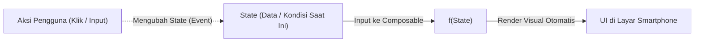
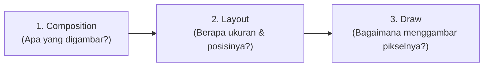
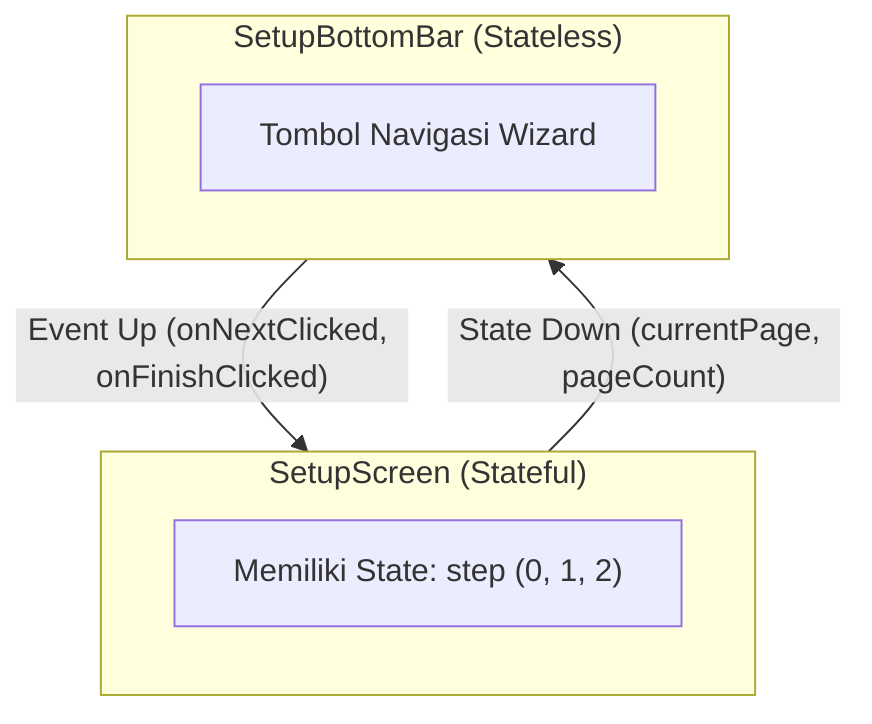
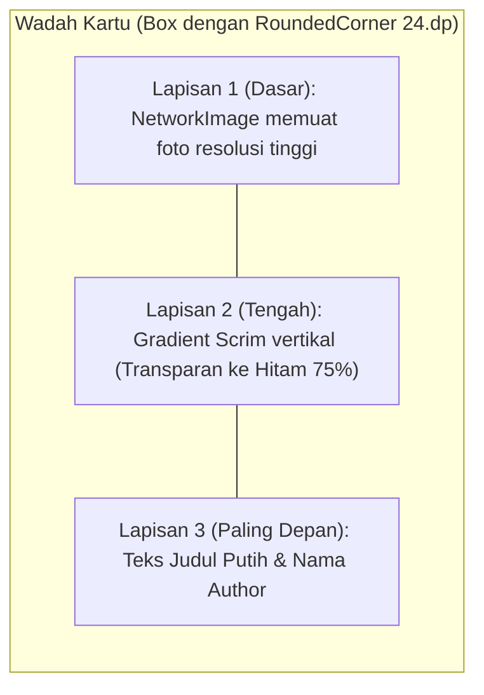
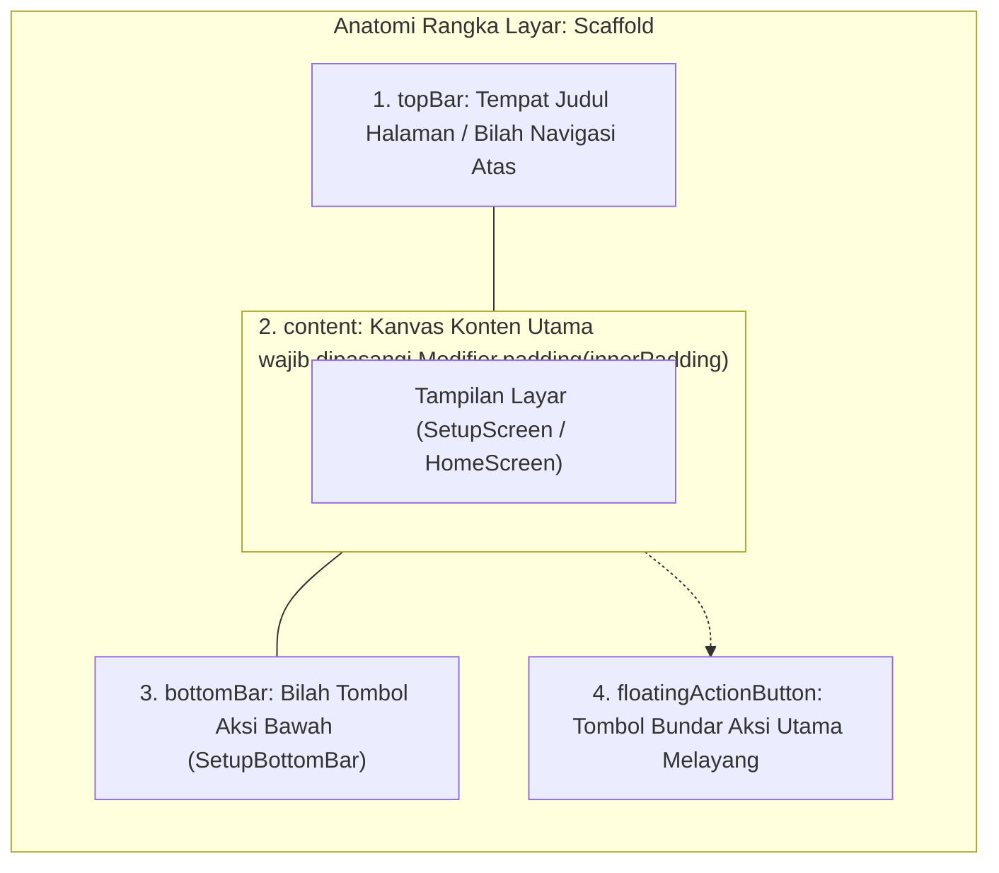

## Gambaran Umum Sesi 2

Selamat datang di materi koding **Sesi 2**!

Di sesi ini, kita mulai membangun antarmuka aplikasi **LuminaWalls** dari kanvas kosong (*blank canvas*). Fokus utama kita adalah memahami cara berpikir deklaratif di Jetpack Compose:
1. **App Gateway**: Menghubungkan titik masuk aplikasi di `MainActivity.kt` ke orkestrator navigasi `LuminaMainApp()`.
2. **Setup Onboarding Wizard**: Menyusun alur orientasi 3 langkah (Sambutan, Pilih Tema, dan Selesai) menggunakan animasi geser.
3. **Komponen Interaktif**: Membuat tombol dinamis wizard di `SetupComponents.kt` yang bisa berubah teks dan aksinya.
4. **Stacking Card**: Merakit kartu wallpaper berlapis (`WallpaperCard.kt`) menggunakan `Box`, gradasi hitam (*scrim*), dan teks judul.
5. **Kanvas Beranda**: Menampilkan 2 kartu wallpaper dummy perdana di `HomeScreen.kt`.

Seluruh kode yang kamu tulis di bawah ini dipasangkan langsung ke baris komentar `// TODO: [Session 2]` yang sudah tersedia di template proyek.

---

## Pondasi Teori Mendalam: Thinking in Compose

Karena proses koding di Sesi 2 menggunakan templat starter dan blok kode terarah, sebagian besar waktu sesi dapat kita manfaatkan untuk mengupas tuntas cara berpikir deklaratif (*mental model*) di balik Jetpack Compose. Bagian ini membedah teori dari tingkat arsitektur runtime hingga optimasi rendering:

---

### 1. Paradigma UI = f(state) (Imperatif vs Deklaratif)

Di antarmuka Android tradisional (View XML), tampilan adalah pohon objek yang hidup di memori. Setiap elemen seperti `Button` atau `TextView` memiliki state internalnya sendiri. Pengembang bertindak sebagai mandor yang terus-menerus memanggil perintah mutasi imperatif:

```text
// Pendekatan Imperatif (XML Lama - Penuh Risiko Desinkronisasi):
button.setText("Mulai Jelajahi")
button.setEnabled(true)
progressBar.setVisibility(View.GONE)
headerText.setTextColor(Color.GREEN)
```

Jika aplikasi memiliki 5 kondisi layar yang berbeda, pengembang harus mengelola puluhan kombinasi pemanggilan manual tersebut. Jika ada satu kondisi di mana `progressBar.setVisibility(View.GONE)` lupa dipanggil, antarmuka akan mengalami bug desinkronisasi.

Di Jetpack Compose, tampilan antarmuka (UI) hanyalah fungsi matematis murni dari **State**:

$$\text{UI} = f(\text{State})$$



Di Compose, kita tidak pernah mengubah antarmuka secara paksa. Kita hanya mendeskripsikan aturan wujud tampilan untuk setiap nilai data:

```kotlin
// Pendekatan Deklaratif (Compose - Bebas Bug Desinkronisasi):
Button(
    onClick = if (isLastPage) onFinishClicked else onNextClicked,
    enabled = isEnabled,
) {
    Text(text = stringResource(if (isLastPage) R.string.action_get_started else R.string.action_next))
}
```

Saat data `isLastPage` berganti dari `false` menjadi `true`, sistem Android secara mandiri menggambar ulang tombol tersebut.

> **Analogi Layar Proyektor**:
> XML itu seperti menyuruh tukang mengecat ulang tembok aula setiap kali ada pergantian acara. Jetpack Compose itu seperti proyektor digital: proyektor tidak memiliki warna sendiri, ia hanya memancarkan cahaya berdasarkan slide laptop (State). Begitu file slide di laptop diganti, proyeksi di tembok otomatis berubah tanpa ada yang perlu mengecat tembok.

---

### 2. Tiga Fase Rendering Compose (Composition, Layout, Draw)

Bagaimana sebuah fungsi Kotlin `@Composable` bisa tampil menjadi piksel nyata di layar kaca smartphone? Jetpack Compose memproses antarmuka melalui 3 fase berurutan:



1. **Fase Composition (Tree Construction)**:
   - Compose Compiler mengeksekusi fungsi `@Composable` dan membangun pohon deskripsi UI internal (*Composition Tree / Slot Table*).
   - Di fase ini, Compose menentukan elemen apa saja yang eksis di layar (misal: ada 1 `Column`, 1 `Text`, dan 3 `LuminaListItem`).
2. **Fase Layout (Measure & Placement)**:
   - Setiap elemen mengukur dirinya sendiri (*measure*) dan menentukan koordinat penempatan anak-anaknya (*placement*).
   - Berbeda dengan XML yang sering melakukan pengukuran berulang (*multi-pass measurement*) yang memicu lag pada hierarki bersarang, Compose menjamin **Single-Pass Measurement** ($O(n)$). Layar selesai diukur dalam satu kali tarikan napas.
3. **Fase Draw (Rasterization ke GPU)**:
   - Setelah ukuran dan koordinat piksel (X, Y, Lebar, Tinggi) diketahui pasti, Android melukis elemen tersebut ke kanvas layar menggunakan akselerasi grafis GPU hardware.

> **Tips Performa Kelas Dunia**:
> Jika kita mengubah animasi warna atau rotasi, usahakan membacanya di fase Draw (misalnya menggunakan lambda modifier `Modifier.drawBehind { ... }` atau `Modifier.graphicsLayer { ... }`). Dengan begitu, Fase 1 (Composition) dan Fase 2 (Layout) dilewati sepenuhnya, sehingga animasi berjalan stabil di 120 FPS tanpa membebani CPU!

---

### 3. Snapshot State System & Perbedaan `remember` vs `rememberSaveable`

Mengapa variabel biasa seperti `var step = 0` tidak bisa menggerakkan UI di Compose?

Android membutuhkan variabel yang memiliki "antena pelacak". Di Compose, teknologi ini disebut **Snapshot State System**:
- Saat fungsi Composable membaca variabel `mutableStateOf`, Compose Runtime secara otomatis mendaftarkan Composable tersebut sebagai "pelanggan" (*subscriber*).
- Ketika nilai variabel ditulis ulang (`step = 1`), Compose Runtime menerima sinyal dan memasukkan fungsi tersebut ke dalam antrean **Recomposition**.

```kotlin
// Salah: Nilai step reset ke 0 setiap kali recomposition terjadi!
var step = 0

// Benar untuk siklus hidup biasa: Nilai bertahan selama Composable ada di layar
var step by remember { mutableIntStateOf(0) }

// Sempurna untuk produksi: Nilai bertahan bahkan saat HP diputar (rotasi layar)
var step by rememberSaveable { mutableIntStateOf(0) }
```

#### Mengapa Perlu `rememberSaveable`?
- **`remember`**: Menyimpan nilai di memori RAM selama fungsi Composable masih tertancap di pohon Composition. Namun jika terjadi **Configuration Change** (seperti smartphone diputar dari orientasi tegak ke mendatar, atau pengguna berganti mode gelap), Activity Android dihancurkan dan dibuat ulang oleh OS. Akibatnya, nilai di dalam `remember` akan hilang kembali ke angka 0.
- **`rememberSaveable`**: Secara otomatis menitipkan nilai variabel ke dalam brankas `SavedStateRegistry` (Android Bundle). Saat layar diputar, nilai tersebut dipulihkan kembali secara ajaib sehingga pengguna tidak kehilangan progres wizard mereka!

---

### 4. State Hoisting & Unidirectional Data Flow (UDF)

Salah satu prinsip terpenting dalam arsitektur software modern adalah **Separation of Concerns** (Pemisahan Tanggung Jawab). 

Jika sebuah komponen antarmuka menyimpan state-nya sendiri, komponen tersebut menjadi sulit diuji (*hard to test*) dan kaku karena tidak bisa dipakai di tempat lain. Kita membagi komponen menjadi dua jenis:
- **Stateful Component**: Komponen yang memiliki dan mengelola state (contoh: `SetupScreen` yang menyimpan variabel `step`).
- **Stateless Component**: Komponen murni yang tidak menyimpan state apapun, ia hanya menerima data dan memancarkan aksi (contoh: `SetupBottomBar`).



Pola ini disebut **Unidirectional Data Flow (UDF)**:
- **State mengalir turun (*State flows down*)**: Nilai data diturunkan dari induk ke anak melalui parameter fungsi biasa.
- **Event mengalir naik (*Events flow up*)**: Aksi pengguna (seperti klik tombol) dinaikkan kembali ke induk melalui fungsi lambda callback.

---

### 5. Komposisi di Atas Pewarisan (Composition over Inheritance) & Slot API

Di era pemrograman berorientasi objek tradisional (OOP/XML), komponen UI dibuat melalui rantai pewarisan kelas (*inheritance*) yang sangat panjang:

$$\text{Button} \to \text{TextView} \to \text{View} \to \text{Object}$$

Akibatnya, kelas `Button` membawa ratusan fungsi dan beban memori dari `TextView` yang sebenarnya tidak selalu dibutuhkan. Jika kita ingin membuat tombol yang di dalamnya ada ikon di sebelah kiri, progress bar di tengah, dan badge angka di sebelah kanan, XML menjadi sangat rumit.

Jetpack Compose meninggalkan konsep pewarisan dan beralih ke **Slot API**:
Sebuah Composable dapat menyediakan "slot kosong" berupa parameter lambda `@Composable () -> Unit`. Pengembang bebas memasukkan komponen apapun ke dalam slot tersebut:

```kotlin
// Contoh Slot API pada LuminaListItem:
@Composable
fun LuminaListItem(
    title: String,
    subtitle: String,
    leadingContent: @Composable (() -> Unit)? = null, // Slot Kosong di Kiri
    trailingContent: @Composable (() -> Unit)? = null, // Slot Kosong di Kanan
    onClick: () -> Unit,
)
```

Dengan Slot API, kita bisa menaruh ikon vector, foto lingkaran, kotak centang (*checkbox*), atau animasi lottie di dalam `leadingContent` tanpa perlu mengubah kode internal `LuminaListItem`. Pola ini memberikan fleksibilitas tanpa batas dengan kode yang sangat bersih.

---

### 6. Sistem Modifier: Urutan Eksekusi Menentukan Hasil

`Modifier` adalah instrumen utama di Compose untuk mengatur ukuran, tata letak, dekorasi latar belakang, dan interaksi sentuhan.

Satu aturan emas yang wajib diingat: **Urutan rantai pemanggilan Modifier sangat berpengaruh (*Order Matters*)**, karena Modifier dibungkus secara berurutan dari luar ke dalam (*decorator pattern*).

Mari kita bandingkan dua urutan berikut:

```kotlin
// Kasus A: Padding dulu, baru Background
Modifier
    .padding(16.dp)
    .background(Color.Red)
// Hasil A: Muncul ruang kosong transparan 16.dp di luar, lalu kotak merah di dalamnya.

// Kasus B: Background dulu, baru Padding
Modifier
    .background(Color.Red)
    .padding(16.dp)
// Hasil B: Seluruh kotak diwarnai merah penuh, lalu konten di dalamnya berjarak 16.dp dari tepi merah.
```

Pada `WallpaperCard.kt`, kita menyusun modifier dengan urutan:
1. `.fillMaxWidth()` $\to$ Memastikan kartu selebar kolom yang tersedia.
2. `.aspectRatio(0.72f)` $\to$ Mengunci proporsi tinggi-lebar kartu poster wallpaper.
3. `.bouncyClickable(...)` $\to$ Dipasang di akhir agar efek animasi pantulan dan haptic mencakup seluruh permukaan kartu yang sudah terbentuk sempurna.

---

### 7. Anatomi Tumpukan Lapisan (Z-Axis Stacking) pada `WallpaperCard`

Pada kartu wallpaper, kita menggunakan kontainer `Box`. Tidak seperti `Column` (yang menyusun elemen ke bawah) atau `Row` (yang menyusun ke samping), `Box` menyusun elemen saling bertumpuk di sumbu Z (kedalaman):



> **Mengapa Scrim Gradasi Hitam Sangat Krusial?**
> Di aplikasi galeri atau wallpaper, gambar foto yang dimuat pengguna tidak bisa diprediksi. Ada wallpaper bertema gelap, dan banyak pula yang bertema putih terang (seperti salju atau awan). Jika kita langsung menaruh teks putih di atas foto salju, teks akan hilang (*unreadable*). Gradasi hitam (*scrim*) memastikan rasio kontras warna selalu memenuhi standar aksesibilitas internasional (**WCAG AA**), sehingga teks selalu terbaca tajam di atas wallpaper apapun!

---

### 8. Animasi Deklaratif: `AnimatedContent` vs Animasi Tradisional

Di Sesi 2, wizard onboarding berpindah halaman dengan animasi geser (*slide horizontal*) dan transisi pudar (*crossfade*).

Bandingkan cara membuatnya di masa lalu vs sekarang:

- **Cara Lama (XML)**:
  - Membuat berkas XML terpisah di folder `res/anim/slide_in_right.xml`, `slide_out_left.xml`.
  - Menulis interpolator kurva bezier di XML.
  - Mengikat listener `Animation.AnimationListener` di Activity.
  - Menangani pembatalan animasi jika pengguna mengetuk tombol berkali-kali secara cepat (*race condition*).
- **Cara Baru (Compose)**:
  - Cukup bungkus tampilan dengan fungsi `AnimatedContent(targetState = step)`.
  - Tentukan aturan transisinya dalam satu baris ekspresif:

```kotlin
AnimatedContent(
    targetState = step,
    transitionSpec = {
        if (targetState > initialState) {
            (slideInHorizontally { width -> width } + fadeIn())
                .togetherWith(slideOutHorizontally { width -> -width } + fadeOut())
        } else {
            (slideInHorizontally { width -> -width } + fadeIn())
                .togetherWith(slideOutHorizontally { width -> width } + fadeOut())
        }
    }
) { targetStep ->
    // Gambar tampilan langkah yang sesuai
}
```

Compose secara otomatis menghitung interpolasi pergerakan piksel di setiap frame layar (60 Hz sampai 120 Hz) menggunakan kurva pegas (*spring physics*) yang sangat halus dan tahan terhadap interupsi klik pengguna.

---

### 9. Kamus Transisi: XML View Klasik vs Jetpack Compose

Bagi peserta yang sudah pernah belajar pemrograman Android berbasis XML atau ingin memetakan konsep lama ke paradigma baru, berikut tabel konversi praktisnya:

| Konsep / Komponen di XML Lama | Padanan Resmi di Jetpack Compose | Keterangan & Karakteristik |
|---|---|---|
| `<TextView android:text="..." />` | `Text(text = "...")` | Komponen tipografi teks deklaratif |
| `<ImageView android:src="..." />` | `Image(...)` / `NetworkImage(...)` | Komponen penampil gambar lokal / remote |
| `<LinearLayout orientation="vertical">` | `Column(...) { ... }` | Menyusun elemen berurutan secara vertikal |
| `<LinearLayout orientation="horizontal">` | `Row(...) { ... }` | Menyusun elemen berurutan secara horizontal |
| `<FrameLayout>` | `Box(...) { ... }` | Menumpuk elemen secara berlapis (sumbu Z) |
| `<ScrollView>` | `Modifier.verticalScroll(rememberScrollState())` | Memberikan kemampuan gulir pada kontainer |
| `<RecyclerView>` | `LazyColumn` / `LazyVerticalGrid` | Daur ulang komponen secara efisien saat digulir |
| `findViewById<Button>(R.id.btn)` | *Ditiadakan sepenuhnya* | Tidak perlu pencarian ID, langsung ikat ke State |
| `button.setOnClickListener { ... }` | `Button(onClick = { ... })` atau `Modifier.clickable { ... }` | Interaksi klik berbasis fungsi lambda |
| `<ProgressBar style="?android:attr/progressBarStyle" />` | `CircularProgressIndicator()` | Indikator putar loading Material 3 |
| `res/values/styles.xml` & `themes.xml` | `MaterialTheme { ... }` | Sistem pewarnaan dan tipografi berbasis tema objek Kotlin |

---

### 10. Membedah Scaffold & Istilah Komponen yang Asing bagi Pemula

Bagi peserta yang baru pertama kali menyentuh Jetpack Compose, banyak istilah dan komponen yang terdengar asing. Berikut bedah konsep komponen-komponen kunci tersebut:

#### A. Apa itu `Scaffold`? (Rangka Perancah Layar Penuh)
Secara harfiah dalam dunia konstruksi, *scaffold* adalah perancah (rangka bambu atau besi penyangga saat membangun gedung).

Di Android Material Design, **`Scaffold`** adalah kerangka pondasi standar satu layar penuh. Tanpa `Scaffold`, pengembang harus menghitung koordinat dan posisi bilah atas, bilah bawah, dan tombol melayang secara manual agar tidak saling bertubrukan.



`Scaffold` menyediakan "cantolan resmi" (*slots*):
- `topBar`: Tempat meletakkan judul layar atau tombol kembali (`TopAppBar`).
- `bottomBar`: Tempat meletakkan tombol navigasi wizard (`SetupBottomBar`) atau bilah menu navigasi bawah (`NavigationBar`).
- `floatingActionButton`: Tempat tombol aksi cepat bundar melayang (*FAB*).
- `snackbarHost`: Tempat memunculkan pesan melayang singkat (*pop-up snackbar*).
- `content`: Ruang kanvas utama untuk antarmuka aplikasimu.

#### Mengapa Parameter `innerPadding` Mutlak Wajib Dipasang?
Perhatikan blok penulisan konten pada `Scaffold`:

```kotlin
Scaffold(
    bottomBar = { SetupBottomBar(...) }
) { innerPadding ->
    // innerPadding adalah tiket keamanan layout-mu!
    Column(
        modifier = Modifier
            .fillMaxSize()
            .padding(innerPadding) // Wajib dipasang di sini!
    ) {
        ...
    }
}
```

> **Hukum Wajib Scaffold**:
> Parameter `innerPadding` (bertipe `PaddingValues`) adalah hasil kalkulasi otomatis sistem Android yang menghitung tinggi pasti dari `topBar`, `bottomBar`, dan insets navigasi sistem. Jika kamu lupa memasang `.padding(innerPadding)` pada kontainer utamamu, konten aplikasi akan tenggelam dan tertabrak tepat di belakang tombol bilah bawah!

---

#### B. `Surface` vs `Box`: Kapan Harus Menggunakan yang Mana?
Banyak pemula bertanya: *"Kenapa ada Surface kalau sudah ada Box?"*

- **`Box` (Wadah Tata Letak Polos)**:
  - Hanyalah wadah layout murni untuk menumpuk elemen secara 3 dimensi (sumbu Z).
  - Tidak memiliki kecerdasan tema, tidak mengatur warna teks otomatis, dan tidak memiliki elevasi bayangan.
- **`Surface` (Lempengan Material Design Cerdas)**:
  - Komponen resmi Material 3 yang merepresentasikan selembar kertas/lempengan fisik yang memiliki kedalaman.
  - **Kesadaran Warna Otomatis (*Color Awareness*)**: Saat kamu memberi warna `Surface` menjadi gelap, seluruh komponen `Text` atau `Icon` di dalamnya secara otomatis berubah menjadi putih (*onSurface*) tanpa perlu kamu atur manual satu per satu!
  - **Bentuk & Elevasi**: Memiliki parameter pemotongan sudut (`shape = RoundedCornerShape(24.dp)`) dan parameter bayangan timbul (`shadowElevation = 4.dp`).

---

#### C. `Modifier`: Baju Zirah & Buku Panduan Komponen
Jika fungsi Composable menentukan **SIAPA DIRINYA** (`Text` adalah teks, `Button` adalah tombol), maka `Modifier` menentukan **BAGAIMANA PENAMPILAN DAN PERILAKUNYA**:
- Seberapa lebar dan tingginya (`fillMaxSize`, `size`, `aspectRatio`).
- Seberapa jauh jaraknya dari tetangga (`padding`).
- Bagaimana latar belakangnya (`background`, `border`, `clip`).
- Bagaimana ia merespons sentuhan jari (`clickable`, `bouncyClickable`).

> **Analogi**:
> Composable adalah tubuh manusia, sedangkan `Modifier` adalah pakaian, sepatu, jam tangan, dan tas yang dikenakan. Tubuh yang sama bisa berpakaian santai untuk olahraga, atau mengenakan setelan jas resmi untuk pesta, hanya dengan mengganti rantai `Modifier`-nya.

---

#### D. `Icons.AutoMirrored`: Ikon Cerdas Adaptif Global
Di berkas `SetupComponents.kt`, kita menggunakan impor ikon:

```kotlin
import androidx.compose.material.icons.automirrored.filled.ArrowForward
```

Mengapa tidak menggunakan `Icons.Default.ArrowForward` biasa?
- Di dunia internasional, jutaan pengguna menggunakan bahasa yang dibaca dari kanan ke kiri (**RTL / Right-to-Left**) seperti bahasa Arab, Persia, Urdu, dan Ibrani.
- Pada sistem RTL, alur "maju ke depan" (*forward*) secara psikologis mengarah ke arah kiri, bukan ke kanan!
- Fitur `AutoMirrored` adalah kecerdasan bawaan Jetpack Compose: jika smartphone pengguna disetel ke bahasa Arab, ikon panah maju otomatis memutar dirinya sendiri menghadap ke kiri secara cerdas tanpa pengembang perlu membuat logika if-else terpisah.

---

#### E. Perbedaan `Arrangement` vs `Alignment` pada Kolom dan Baris
Dua istilah ini sering tertukar saat pemula mengatur tata letak:
- **`Arrangement` (Sumbu Utama / Main-Axis)**:
  - Mengatur posisi dan pembagian jarak antar anak di sumbu yang searah dengan alur kontainer.
  - Pada `Column` (sumbu vertikal): `Arrangement.Center` menaruh anak di tengah vertikal, `Arrangement.SpaceBetween` mendorong anak ke ujung atas dan bawah, `Arrangement.spacedBy(10.dp)` memberi celah 10 dp antar anak.
- **`Alignment` (Sumbu Silang / Cross-Axis)**:
  - Mengatur posisi anak di sumbu yang tegak lurus dengan kontainer.
  - Pada `Column` (sumbu silangnya horizontal): `Alignment.CenterHorizontally` menaruh anak di tengah horizontal layar, `Alignment.Start` merapatkan anak ke tepi kiri.

---

## Panduan Instruktur & Speaker Playbook (Sesi 2)

Bagian ini dirancang khusus untuk Instruktur dan Co-Instructor sebagai panduan ritme kelas selama 120 menit:

### 1. Master Rundown 120 Menit Sesi 2

| Waktu | Durasi | Agenda | Fokus Pembahasan & Aktivitas |
|---|---|---|---|
| 00:00 - 00:10 | 10 Menit | Pembukaan & Review Sesi 1 | Cek kesiapan perangkat fisik peserta dan review hasil Splash Screen dari Sesi 1. |
| 00:10 - 00:50 | 40 Menit | Teori Mendalam: Thinking in Compose | Kupas tuntas paradigma `UI = f(state)`, 3 Fase Rendering, Snapshot State System, Slot API, urutan Modifier, dan perbandingan dengan XML. |
| 00:50 - 01:25 | 35 Menit | Hands-on Koding Cepat (Langkah 1 s/d 6) | Alur copas terarah ke TODO: Hubungkan `MainActivity`, isi data dummy, lengkapi wizard di `SetupScreen`, rakit `WallpaperCard`, dan render di `HomeScreen`. |
| 01:25 - 01:45 | 20 Menit | Bedah Kode & Mini-Tantangan | Bedah mengapa kode berjalan, uji coba rotasi layar (`rememberSaveable`), dan tweak parameter kartu (`aspectRatio`, `spacedBy`). |
| 01:45 - 01:55 | 10 Menit | Sesi Tanya Jawab (Q&A) | Buka diskusi mendalam tentang arsitektur Compose, performa rendering, dan tantangan peserta. |
| 01:55 - 02:00 | 5 Menit | Git Checkpoint & Penutup | Eksekusi commit Sesi 2 ke Git lokal dan preview materi Sesi 3 (Grid & DataStore). |

---

### 2. Strategi Penyampaian: Fokus "The Why", Bukan Sekadar "The How"
Karena peserta menggunakan sistem salin-tempel blok kode per TODO dari dokumentasi, peran utamamu adalah membedah alasan di balik tiap baris kode:
1. **Perlihatkan Masalah Dulu di Layar**: Sebelum menyuruh peserta menempel kode, tunjukkan kondisi aplikasi saat ini di proyektor (misalnya: "Lihat, tombol wizard di bawah belum muncul dan belum bisa diklik").
2. **Instruksikan Peserta Membuka File & Baris TODO**: Arahkan nama berkas dan baris TODO secara spesifik.
3. **Bedah Logikanya Begitu Kode Berjalan**:
   - Tunjukkan bagaimana `AnimatedContent` otomatis memberikan animasi transisi slide horizontal tanpa perlu konfigurasi XML transition yang rumit.
   - Jelaskan peran `bouncyClickable` di `WallpaperCard` yang memberikan haptic dan efek pegas saat kartu ditekan.

---

### 3. Pertanyaan Pancingan untuk Menghidupkan Kelas
Gunakan pertanyaan ini untuk menguji pemahaman peserta saat live coding:
- *"Teman-teman, kira-kira kalau variabel `step` di `SetupScreen` tidak dibungkus `remember`, apa yang terjadi saat layar smartphone kita putar (rotasi horizontal)?"*  
  *(Jawaban: Nilai step akan reset kembali ke 0 karena Activity dibuat ulang).*
- *"Mengapa teks author dan judul di WallpaperCard kita beri lapisan hitam transparan (scrim) di bawahnya?"*  
  *(Jawaban: Supaya teks putih tetap terbaca tajam meskipun gambar wallpapernya berwarna putih terang).*

---

### 4. Mini-Tantangan Cepat (30 Detik)
Setelah peserta berhasil menampilkan kartu di `HomeScreen`, berikan tantangan santai ini:
- **Tantangan Rasio Kartu**: "Coba buka `WallpaperCard.kt`, cari baris `.aspectRatio(0.72f)` lalu ganti nilainya menjadi `1f`. Simpan dan jalankan: lihat kartunya sekarang berubah menjadi bujur sangkar!"
- **Tantangan Jarak Tema**: "Di `SetupScreen.kt`, coba ubah `Arrangement.spacedBy(10.dp)` menjadi `24.dp`. Perhatikan bagaimana jarak antar opsi tema langsung merenggang."

---

### 5. Antisipasi Kendala Teknis Peserta
- **Error Merah Unresolved Reference**: 90% disebabkan peserta lupa menambahkan import di bagian atas berkas. Ingatkan peserta untuk memeriksa blok import di setiap langkah.
- **Tampilan Terpotong Status Bar**: Ingatkan peserta bahwa fungsi `enableEdgeToEdge()` di `MainActivity` membuat konten menggambar hingga ke belakang status bar. Karena itu komponen kita membutuhkan modifier `padding` atau penanganan insets sistem.

---

## Langkah 1: Hubungkan Gerbang Aplikasi di `MainActivity.kt`

Buka berkas `app/src/main/kotlin/com/gdgoc/luminawalls/MainActivity.kt`.

### 1. Tambahkan Import di Bagian Atas
Pastikan berkas mengimpor komponen orkestrator dan SplashScreen di baris import paling atas:

```kotlin
import androidx.core.splashscreen.SplashScreen.Companion.installSplashScreen
import com.gdgoc.luminawalls.ui.LuminaMainApp
```

### 2. Ganti Konten Starter dengan Orkestrator
Gunakan `Ctrl + F` (atau `Cmd + F` di Mac) untuk mencari baris komentar berikut:

```kotlin
            // TODO: [Session 2] Hapus Greeting(), ganti dengan gerbang state isSetupCompleted (SetupScreen vs HomeScreen) di bawah sini:
```

Hapus blok `Surface { Greeting("Android") }` bawaan template di dalam `setContent`, lalu ganti dengan memanggil orkestrator aplikasi:

```kotlin
            LuminaMainApp()
```

Sehingga keseluruhan berkas `MainActivity.kt` menjadi bersih dan rapi seperti ini:

```kotlin
package com.gdgoc.luminawalls

import android.os.Bundle
import androidx.activity.ComponentActivity
import androidx.activity.compose.setContent
import androidx.activity.enableEdgeToEdge
import androidx.core.splashscreen.SplashScreen.Companion.installSplashScreen
import com.gdgoc.luminawalls.ui.LuminaMainApp

class MainActivity : ComponentActivity() {
    override fun onCreate(savedInstanceState: Bundle?) {
        val splashScreen = installSplashScreen()
        super.onCreate(savedInstanceState)
        enableEdgeToEdge()

        setContent {
            // TODO: [Session 2] Hapus Greeting(), ganti dengan gerbang state isSetupCompleted (SetupScreen vs HomeScreen) di bawah sini:
            LuminaMainApp()
        }
    }
}
```

> `LuminaMainApp()` bertindak sebagai nahkoda utama aplikasi. Di dalamnya sudah disiapkan gerbang state: jika pengguna baru pertama kali membuka aplikasi, sistem otomatis menampilkan `SetupScreen`. Jika proses onboarding sudah pernah diselesaikan, aplikasi langsung mengarahkan pengguna ke halaman utama `HomeScreen`.

---

## Langkah 2: Isi Data Dummy Wallpaper di `WallpaperRepository.kt`

Buka berkas `app/src/main/kotlin/com/gdgoc/luminawalls/data/repository/WallpaperRepository.kt`.

Cari baris komentar berikut:

```kotlin
    // TODO: [Session 2] Inisialisasi daftar wallpaper dummy awal untuk kanvas Home Screen di bawah sini:
```

Tepat di bawah baris komentar tersebut, ubah deklarasi `private val initialWallpapers = emptyList<Wallpaper>()` menjadi:

```kotlin
    private val initialWallpapers = listOf(
        Wallpaper(
            id = "1",
            title = "lone",
            author = "Yanto",
            category = "Anu",
            tags = listOf("Cyber", "Minimalist"),
        ),
        Wallpaper(
            id = "2",
            title = "Sunset Bloom",
            author = "Ariya",
            category = "Nature",
            tags = listOf("Nature", "Sunset"),
        ),
    )
```

> Sebelum kita menghubungkan aplikasi ke REST API Cloudflare di Sesi 5, kita menyediakan dua data dummy lokal ini agar kanvas galeri tidak kosong dan kartu wallpaper bisa langsung kita uji coba di layar smartphone.
>
> **Catatan Import**: Berkas `WallpaperRepository.kt` pada langkah ini tidak memerlukan impor tambahan karena model `Wallpaper` sudah berada dalam package data yang sama.

---

## Langkah 3: Tambahkan Tombol Navigasi Wizard di `SetupComponents.kt`

Buka berkas `app/src/main/kotlin/com/gdgoc/luminawalls/ui/components/SetupComponents.kt`.

### 1. Tambahkan Import di Bagian Atas
Pastikan impor berikut sudah tersedia di bagian paling atas berkas:

```kotlin
import androidx.compose.foundation.layout.width
import androidx.compose.ui.res.stringResource
import com.gdgoc.luminawalls.R
```

### 2. Pasang Tombol Navigasi Dinamis
Cari baris komentar berikut di dalam fungsi `SetupBottomBar`:

```kotlin
            // TODO: [Session 2] Tulis Button navigasi wizard ("Lanjut" / "Mulai Jelajahi") di bawah sini:
```

Tempel kode tombol Material 3 berikut tepat di bawah komentar tersebut:

```kotlin
            Button(
                onClick = if (isLastPage) onFinishClicked else onNextClicked,
                enabled = isEnabled,
                shape = RoundedCornerShape(20.dp),
                colors = ButtonDefaults.buttonColors(
                    containerColor = MaterialTheme.colorScheme.primary,
                    contentColor = MaterialTheme.colorScheme.onPrimary,
                ),
                modifier = Modifier.height(50.dp),
            ) {
                Text(
                    text = stringResource(if (isLastPage) R.string.action_get_started else R.string.action_next),
                    style = MaterialTheme.typography.labelLarge,
                    fontFamily = GoogleSansRounded,
                    fontWeight = FontWeight.Bold,
                )
                Spacer(modifier = Modifier.width(8.dp))
                Icon(
                    imageVector = if (isLastPage) Icons.Default.Check else Icons.AutoMirrored.Filled.ArrowForward,
                    contentDescription = null,
                    modifier = Modifier.size(18.dp),
                )
            }
```

> Tombol ini bersifat reaktif (*state-driven*): jika pengguna masih berada di halaman 1 atau 2, tombol menampilkan teks "Lanjut" dengan ikon panah. Namun ketika pengguna mencapai halaman terakhir, tombol otomatis berubah menjadi "Mulai Jelajahi" dengan ikon centang.

---

## Langkah 4: Lengkapi Alur Langkah di `SetupScreen.kt`

Buka berkas `app/src/main/kotlin/com/gdgoc/luminawalls/ui/setup/SetupScreen.kt`.

### 1. Tambahkan Import di Bagian Atas
Pastikan baris impor berikut sudah ada di bagian paling atas berkas:

```kotlin
import androidx.compose.foundation.layout.Spacer
import androidx.compose.foundation.layout.fillMaxWidth
import androidx.compose.foundation.layout.height
import androidx.compose.foundation.shape.RoundedCornerShape
import androidx.compose.ui.res.stringResource
import com.gdgoc.luminawalls.R
import com.gdgoc.luminawalls.ui.components.LuminaListItem
import com.gdgoc.luminawalls.ui.components.SetupBottomBar
import com.gdgoc.luminawalls.ui.components.SetupHeader
```

Di berkas ini terdapat empat slot TODO yang perlu kita isi secara berurutan:

### 2. Pasang Bottom Bar Wizard di `SetupScreen`
Cari komentar di dalam parameter `bottomBar = { ... }`:

```kotlin
            // TODO: [Session 2] Tulis SetupBottomBar untuk tombol navigasi wizard (Next / Finish) di bawah sini:
```

Tempel pemanggilan komponen bar bawah berikut tepat di bawahnya:

```kotlin
            SetupBottomBar(
                currentPage = step,
                pageCount = pageCount,
                onNextClicked = { if (step < pageCount - 1) step += 1 },
                onFinishClicked = onFinished,
                isNextButtonEnabled = true,
                isFinishButtonEnabled = true,
            )
```

### 3. Header Sambutan Langkah 1 di `WelcomeStep()`
Gulir ke fungsi `WelcomeStep()`, lalu cari komentar:

```kotlin
        // TODO: [Session 2] Tulis SetupHeader sambutan pembuka di bawah sini:
```

Tempel pemanggilan header pembuka berikut:

```kotlin
        SetupHeader(
            title = stringResource(R.string.setup_welcome_title),
            subtitle = stringResource(R.string.setup_welcome_subtitle),
        )
```

### 4. Header & Opsi Tema Langkah 2 di `PersonalizationStep()`
Gulir ke fungsi `PersonalizationStep()`, lalu cari komentar:

```kotlin
        // TODO: [Session 2] Tulis SetupHeader pemilihan tema di bawah sini:
```

Tempel header pemilihan tema:

```kotlin
        SetupHeader(
            title = stringResource(R.string.setup_theme_title),
            subtitle = stringResource(R.string.setup_theme_subtitle),
        )
```

Tepat di bawahnya pada fungsi yang sama, cari komentar:

```kotlin
        // TODO: [Session 2] Tulis opsi tema menggunakan Column & LuminaListItem di bawah sini:
```

Tempel daftar pilihan tema menggunakan `LuminaListItem`:

```kotlin
        Spacer(modifier = Modifier.height(28.dp))
        Column(
            modifier = Modifier.fillMaxWidth(),
            verticalArrangement = Arrangement.spacedBy(10.dp),
        ) {
            themeOptions.forEach { option ->
                LuminaListItem(
                    title = stringResource(option.titleRes),
                    subtitle = stringResource(option.descriptionRes),
                    shape = RoundedCornerShape(22.dp),
                    onClick = { onThemeModeSelected(option.mode) },
                )
            }
        }
```

> **Catatan Tata Letak Tengah**:
> Kontainer `Column` pembungkus di `PersonalizationStep()` menggunakan `verticalArrangement = Arrangement.Center` dan `modifier = Modifier.fillMaxSize().padding(24.dp)` agar posisi judul dan kartu pilihan tema tersusun rapi pas di tengah layar, senada dengan slide `WelcomeStep()` dan `DoneStep()`.

### 5. Header Penutup Langkah 3 di `DoneStep()`
Gulir ke fungsi `DoneStep()`, lalu cari komentar:

```kotlin
        // TODO: [Session 2] Tulis SetupHeader penutup (selesai) di bawah sini:
```

Tempel header penutup berikut:

```kotlin
        SetupHeader(
            title = stringResource(R.string.setup_done_title),
            subtitle = stringResource(R.string.setup_done_subtitle),
        )
```

> Dengan mengisi keempat bagian ini, wizard onboarding kita kini berfungsi penuh dengan indikator titik halaman, tombol navigasi maju-mundur, dan animasi slide horizontal otomatis bawaan Compose.

---

## Langkah 5: Merakit Stacking Card di `WallpaperCard.kt`

Buka berkas `app/src/main/kotlin/com/gdgoc/luminawalls/ui/components/WallpaperCard.kt`.

### 1. Tambahkan Import di Bagian Atas
Pastikan baris impor berikut sudah tersedia di bagian paling atas berkas:

```kotlin
import androidx.compose.foundation.background
import androidx.compose.foundation.layout.Arrangement
import androidx.compose.foundation.layout.Box
import androidx.compose.foundation.layout.Column
import androidx.compose.foundation.layout.aspectRatio
import androidx.compose.foundation.layout.fillMaxSize
import androidx.compose.foundation.layout.fillMaxWidth
import androidx.compose.foundation.shape.RoundedCornerShape
import androidx.compose.material3.MaterialTheme
import androidx.compose.material3.Surface
import androidx.compose.ui.Alignment
import androidx.compose.ui.graphics.Brush
import androidx.compose.ui.graphics.Color
import androidx.compose.ui.text.font.FontWeight
```

### 2. Rakit Stacking Card Berlapis
Cari baris komentar berikut di dalam fungsi `WallpaperCard`:

```kotlin
    // TODO: [Session 2] Tulis Stacking Card dasar menggunakan Box, Gradient Scrim, dan Text di bawah sini:
```

Tempel implementasi kartu berlapis (*Stacking Card*) berikut tepat di bawahnya:

```kotlin
    Surface(
        shape = RoundedCornerShape(24.dp),
        color = MaterialTheme.colorScheme.surfaceContainerLow,
        modifier = modifier
            .fillMaxWidth()
            .aspectRatio(0.72f)
            .bouncyClickable(onClick = { onWallpaperClick(wallpaper) }),
    ) {
        Box(modifier = Modifier.fillMaxSize()) {
            // Layer 1: Wadah gambar / placeholder
            NetworkImage(
                url = wallpaper.imageUrl,
                contentDescription = wallpaper.title,
                modifier = Modifier.fillMaxSize(),
            )

            // Layer 2: Gradient Scrim hitam tipis agar teks selalu terbaca kontras
            Box(
                modifier = Modifier
                    .fillMaxSize()
                    .background(
                        Brush.verticalGradient(
                            colors = listOf(
                                Color.Transparent,
                                Color.Black.copy(alpha = 0.75f),
                            ),
                            startY = 300f,
                        )
                    )
            )

            // Layer 3: Informasi teks judul & author di pojok kiri bawah
            Column(
                modifier = Modifier
                    .align(Alignment.BottomStart)
                    .padding(16.dp),
                verticalArrangement = Arrangement.spacedBy(4.dp),
            ) {
                Text(
                    text = wallpaper.title,
                    style = MaterialTheme.typography.titleMedium,
                    fontWeight = FontWeight.Bold,
                    color = Color.White,
                )
                Text(
                    text = "By ${wallpaper.author}",
                    style = MaterialTheme.typography.labelSmall,
                    color = Color.White.copy(alpha = 0.8f),
                )
            }
        }
    }
```

> **Prinsip Desain Stacking Card**:
> Menggunakan kontainer `Box`, kita menyusun elemen secara berlapis (z-axis):
> - **Lapisan Bawah**: Gambar wallpaper melalui `NetworkImage`.
> - **Lapisan Tengah**: Gradasi hitam vertikal (*scrim*) dari transparan ke hitam semi-transparan.
> - **Lapisan Atas**: Teks judul dan nama author berwarna putih.
> Gradasi hitam (*scrim*) adalah teknik standar Material Design agar teks putih selalu terbaca tajam dan tidak tenggelam pada wallpaper yang memiliki latar belakang terang.

---

## Langkah 6: Tampilkan Kartu Perdana di `HomeScreen.kt`

Buka berkas `app/src/main/kotlin/com/gdgoc/luminawalls/ui/screens/home/HomeScreen.kt`.

### 1. Tambahkan Import di Bagian Atas
Pastikan baris impor berikut sudah tersedia di bagian paling atas berkas:

```kotlin
import androidx.compose.foundation.layout.Arrangement
import androidx.compose.foundation.layout.Row
import androidx.compose.foundation.layout.fillMaxWidth
import androidx.compose.foundation.layout.padding
import androidx.compose.ui.unit.dp
import com.gdgoc.luminawalls.ui.components.WallpaperCard
```

### 2. Tampilkan Kartu Berdampingan
Cari baris komentar berikut:

```kotlin
        // TODO: [Session 2] Tampilkan Stacking Card awal (WallpaperCard) di bawah sini:
```

Tempel kode penampil kartu berikut tepat di bawah komentar tersebut:

```kotlin
        if (wallpapers.isNotEmpty()) {
            Row(
                modifier = Modifier
                    .fillMaxWidth()
                    .padding(horizontal = 14.dp, vertical = 14.dp),
                horizontalArrangement = Arrangement.spacedBy(10.dp),
            ) {
                wallpapers.take(2).forEach { wallpaper ->
                    WallpaperCard(
                        wallpaper = wallpaper,
                        onWallpaperClick = onWallpaperClick,
                        modifier = Modifier.weight(1f),
                    )
                }
            }
        }
```

> Di Sesi 2 ini, kita menggunakan tata letak horizontal `Row` sederhana untuk menampilkan dua kartu pertama secara berdampingan. Modifier `weight(1f)` memastikan kedua kartu membagi lebar layar secara proporsional dan seimbang.

---

## Uji Coba Jalankan di HP Fisik

1. Hubungkan smartphone Android kamu ke laptop.
2. Klik tombol hijau **Run 'app'** atau tekan shortcut `Shift + F10` di Android Studio.
3. **Uji Coba Alur Wizard**:
   - Di Langkah 1, baca teks sambutan lalu klik tombol **Lanjut**.
   - Di Langkah 2, pilih salah satu opsi tema (Sistem, Gelap, atau Terang) lalu klik **Lanjut**.
   - Di Langkah 3, klik tombol **Mulai Jelajahi**.
4. Perhatikan layar aplikasi: setelah onboarding selesai, aplikasi langsung membuka halaman **Home Screen** dan menampilkan dua kartu wallpaper dummy perdana (*Cyber Horizon* dan *Sunset Bloom*) dengan sudut membulat dan teks yang kontras.

---

## Simpan Checkpoint Sesi 2 ke Git

Buka tab Terminal di Android Studio, lalu jalankan perintah berikut untuk mengunci checkpoint Sesi 2:

```bash
git status
git add .
git commit -m "feat(sesi-2): implement setup wizard, app gateway, and initial stacking cards"
git push origin main
```

Selamat! Kamu sudah berhasil merakit alur onboarding interaktif dan kartu wallpaper perdana. Di **Sesi 3**, kita akan mengubah galeri ini menjadi Grid 2 kolom dinamis dan menyimpan preferensi tema ke memori permanen menggunakan **DataStore Preferences**!
