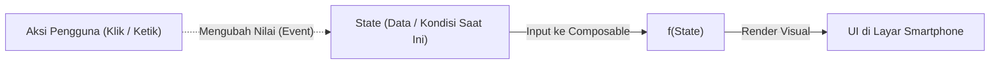
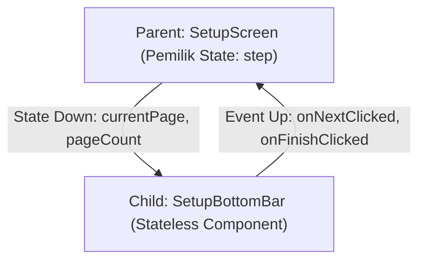
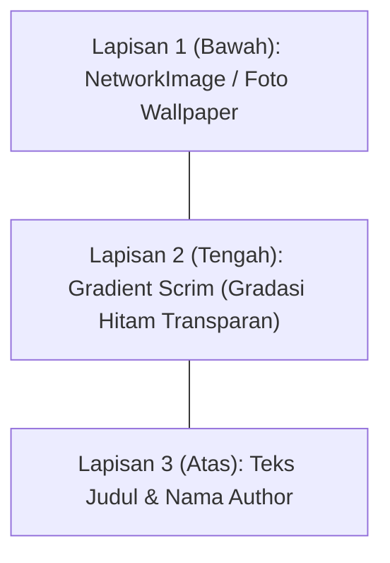

## Gambaran Umum Sesi 2

Selamat datang di materi koding **Sesi 2**!

Di sesi ini, kita mulai membangun antarmuka aplikasi **LuminaWalls** dari kanvas kosong (*blank canvas*). Fokus utama kita adalah memahami cara berpikir deklaratif di Jetpack Compose:
1. **App Gateway**: Menghubungkan titik masuk aplikasi di `MainActivity.kt` ke orkestrator navigasi `LuminaMainApp()`.
2. **Setup Onboarding Wizard**: Menyusun alur orientasi 3 langkah (Sambutan, Pilih Tema, dan Selesai) menggunakan animasi geser.
3. **Komponen Interaktif**: Membuat tombol dinamis wizard di `SetupComponents.kt` yang bisa berubah teks dan aksinya.
4. **Stacking Card**: Merakit kartu wallpaper berlapis (`WallpaperCard.kt`) menggunakan `Box`, gradasi hitam (*scrim*), dan teks judul.
5. **Kanvas Beranda**: Menampilkan 2 kartu wallpaper dummy perdana di `HomeScreen.kt`.

Seluruh kode yang kamu tulis di bawah ini dipasangkan langsung ke baris komentar `// TODO: [Session 2]` yang sudah tersedia di template proyek.

---

## Pondasi Teori: Thinking in Compose

Sebelum menyentuh baris kode, ada perbedaan mendasar antara cara kerja UI Android tradisional (XML) dengan Jetpack Compose yang wajib dipahami:

### 1. Paradigma UI = f(state)
Di Jetpack Compose, tampilan antarmuka (UI) bukanlah objek pohon elemen yang kita ubah propertinya secara manual menggunakan perintah imperatif seperti `button.setText()` atau `progressBar.setVisibility()`. Sebaliknya, UI adalah fungsi matematis dari **State**:

$$\text{UI} = f(\text{State})$$



- **Cara Lama (XML Imperatif)**: Kita bertindak seperti mandor yang memberi instruksi step-by-step: *"Ubah teks tombol jadi 'Mulai', lalu aktifkan tombolnya, lalu sembunyikan loading"*. Jika satu langkah lupa ditulis, UI mengalami bug desinkronisasi.
- **Cara Baru (Compose Deklaratif)**: Kita cukup mendeskripsikan aturan tampilan untuk setiap kondisi:
  - *Jika masih di halaman 1 atau 2*: Tampilkan tombol "Lanjut".
  - *Jika sudah di halaman terakhir*: Tampilkan tombol "Mulai Jelajahi".
  Sistem Android yang bertanggung jawab menggambar ulang tampilan secara otomatis ketika nilai State berubah.

> **Analogi Sederhana**:
> XML itu seperti menyuruh tukang mengecat ulang tembok kamar setiap kali kamu ingin ganti warna. Compose itu seperti layar proyektor: proyektor tidak peduli gambarnya apa, ia hanya memancarkan slide yang ada di laptop. Ganti slide di laptop, layar seketika berubah tanpa perlu mengecat apapun.

---

### 2. Siklus Recomposition & Peran `remember`
- **Recomposition**: Proses ketika Jetpack Compose memanggil ulang fungsi Composable untuk memperbarui tampilan saat State yang dibacanya mengalami perubahan. Compose bekerja cerdas (*intelligent recomposition*): hanya komponen yang membaca data yang berubah yang digambar ulang, sementara komponen statis lainnya tidak disentuh.
- **Mengapa butuh `remember`?**: Karena fungsi Composable dipanggil berulang kali selama siklus hidup aplikasi, semua variabel lokal biasa di dalamnya akan ter-reset ke nilai awal. Fungsi `remember` bertindak sebagai brankas memori lokal yang menjaga nilai variabel tetap hidup dan tidak hilang selama Composable masih aktif di layar.
- **`mutableStateOf`**: Membungkus variabel biasa menjadi variabel reaktif yang memiliki "antena". Ketika nilai di dalamnya ditulis ulang, Compose langsung mendeteksi dan menjadwalkan proses recomposition.

---

### 3. State Hoisting & Unidirectional Data Flow (UDF)
Komponen antarmuka yang baik adalah komponen yang mandiri dan tidak menyimpan state internalnya sendiri (*stateless*):
- **State flows down**: Data atau kondisi mengalir turun dari komponen induk (*parent*) ke komponen anak (*child*) melalui parameter fungsi.
- **Events flow up**: Aksi pengguna (ketukan tombol, geseran layar) mengalir naik dari anak ke induk melalui lambda event callback (`onClick`).



Pada LuminaWalls, `SetupBottomBar` tidak tahu-menahu tentang logika navigasi aplikasi. Ia hanya menerima data nomor halaman (`currentPage`) dari `SetupScreen`, dan melempar event saat tombol ditekan (`onNextClicked`) kembali ke atas. Pola memindahkan kepemilikan state ke komponen induk ini disebut **State Hoisting**.

---

### 4. Mental Model Tata Letak Compose (Stacking Box vs Flow)
- **`Box` (Z-Axis / Kedalaman Berlapis)**: Menumpuk elemen secara 3 dimensi dari belakang ke depan. Digunakan saat merakit `WallpaperCard`:
  - **Lapisan 1 (Bawah)**: Foto wallpaper melalui `NetworkImage`.
  - **Lapisan 2 (Tengah)**: Gradasi hitam transparan (*scrim*) untuk memastikan teks selalu terbaca kontras.
  - **Lapisan 3 (Atas)**: Teks informasi judul dan nama author.



- **`Column` (Y-Axis) & `Row` (X-Axis)**:
  - Menyusun elemen secara linier vertikal atau horizontal.
  - Pahami perbedaan **`Arrangement`** (mengatur posisi dan jarak di sumbu utama) vs **`Alignment`** (mengatur posisi di sumbu silang). Contohnya `verticalArrangement = Arrangement.Center` memastikan seluruh isi kolom berkumpul tepat di tengah vertikal layar smartphone.

---

## Panduan Instruktur & Speaker Playbook (Sesi 2)

Bagian ini dirancang khusus untuk Instruktur dan Co-Instructor sebagai panduan ritme kelas selama 120 menit:

### 1. Master Rundown 120 Menit Sesi 2

| Waktu | Durasi | Agenda | Fokus Pembahasan & Aktivitas |
|---|---|---|---|
| 00:00 - 00:10 | 10 Menit | Pembukaan & Review Sesi 1 | Cek kesiapan perangkat fisik peserta dan review hasil Splash Screen dari Sesi 1. |
| 00:10 - 00:30 | 20 Menit | Teori: Thinking in Compose | Jelaskan konsep `UI = f(state)`, Recomposition, `remember`, dan State Hoisting. |
| 00:30 - 01:10 | 40 Menit | Hands-on Bagian 1 (Wizard) | Langkah 1 s/d Langkah 4: Hubungkan `MainActivity`, isi data dummy, buat `SetupBottomBar`, dan selesaikan wizard di `SetupScreen`. |
| 01:10 - 01:45 | 35 Menit | Hands-on Bagian 2 (Kartu) | Langkah 5 & Langkah 6: Rakit Stacking Card `WallpaperCard` dan render 2 kartu perdana di `HomeScreen`. |
| 01:45 - 01:55 | 10 Menit | Mini-Tantangan Eksperimen | Peserta mencoba tweak parameter UI (aspek rasio, jarak antar komponen) secara mandiri. |
| 01:55 - 02:00 | 5 Menit | Git Checkpoint & Penutup | Eksekusi commit Sesi 2 ke Git lokal dan preview materi Sesi 3 (Grid & DataStore). |

---

### 2. Strategi Penyampaian: Fokus "The Why", Bukan Sekadar "The How"
Karena peserta menggunakan sistem salin-tempel blok kode per TODO dari dokumentasi, peran utamamu adalah membedah alasan di balik tiap baris kode:
1. **Perlihatkan Masalah Dulu di Layar**: Sebelum menyuruh peserta menempel kode, tunjukkan kondisi aplikasi saat ini di proyektor (misalnya: "Lihat, tombol wizard di bawah belum muncul dan belum bisa diklik").
2. **Instruksikan Peserta Membuka File & Baris TODO**: Arahkan nama berkas dan baris TODO secara spesifik.
3. **Bedah Logikanya Begitu Kode Berjalan**:
   - Tunjukkan bagaimana `AnimatedContent` otomatis memberikan animasi transisi slide horizontal tanpa perlu konfigurasi XML transition yang rumit.
   - Jelaskan peran `bouncyClickable` di `WallpaperCard` yang memberikan haptic dan efek pegas saat kartu ditekan.

---

### 3. Pertanyaan Pancingan untuk Menghidupkan Kelas
Gunakan pertanyaan ini untuk menguji pemahaman peserta saat live coding:
- *"Teman-teman, kira-kira kalau variabel `step` di `SetupScreen` tidak dibungkus `remember`, apa yang terjadi saat layar smartphone kita putar (rotasi horizontal)?"*  
  *(Jawaban: Nilai step akan reset kembali ke 0 karena Activity dibuat ulang).*
- *"Mengapa teks author dan judul di WallpaperCard kita beri lapisan hitam transparan (scrim) di bawahnya?"*  
  *(Jawaban: Supaya teks putih tetap terbaca tajam meskipun gambar wallpapernya berwarna putih terang).*

---

### 4. Mini-Tantangan Cepat (30 Detik)
Setelah peserta berhasil menampilkan kartu di `HomeScreen`, berikan tantangan santai ini:
- **Tantangan Rasio Kartu**: "Coba buka `WallpaperCard.kt`, cari baris `.aspectRatio(0.72f)` lalu ganti nilainya menjadi `1f`. Simpan dan jalankan: lihat kartunya sekarang berubah menjadi bujur sangkar!"
- **Tantangan Jarak Tema**: "Di `SetupScreen.kt`, coba ubah `Arrangement.spacedBy(10.dp)` menjadi `24.dp`. Perhatikan bagaimana jarak antar opsi tema langsung merenggang."

---

### 5. Antisipasi Kendala Teknis Peserta
- **Error Merah Unresolved Reference**: 90% disebabkan peserta lupa menambahkan import di bagian atas berkas. Ingatkan peserta untuk memeriksa blok import di setiap langkah.
- **Tampilan Terpotong Status Bar**: Ingatkan peserta bahwa fungsi `enableEdgeToEdge()` di `MainActivity` membuat konten menggambar hingga ke belakang status bar. Karena itu komponen kita membutuhkan modifier `padding` atau penanganan insets sistem.

---

## Langkah 1: Hubungkan Gerbang Aplikasi di `MainActivity.kt`

Buka berkas `app/src/main/kotlin/com/gdgoc/luminawalls/MainActivity.kt`.

### 1. Tambahkan Import di Bagian Atas
Pastikan berkas mengimpor komponen orkestrator dan SplashScreen di baris import paling atas:

```kotlin
import androidx.core.splashscreen.SplashScreen.Companion.installSplashScreen
import com.gdgoc.luminawalls.ui.LuminaMainApp
```

### 2. Ganti Konten Starter dengan Orkestrator
Gunakan `Ctrl + F` (atau `Cmd + F` di Mac) untuk mencari baris komentar berikut:

```kotlin
            // TODO: [Session 2] Hapus Greeting(), ganti dengan gerbang state isSetupCompleted (SetupScreen vs HomeScreen) di bawah sini:
```

Hapus blok `Surface { Greeting("Android") }` bawaan template di dalam `setContent`, lalu ganti dengan memanggil orkestrator aplikasi:

```kotlin
            LuminaMainApp()
```

Sehingga keseluruhan berkas `MainActivity.kt` menjadi bersih dan rapi seperti ini:

```kotlin
package com.gdgoc.luminawalls

import android.os.Bundle
import androidx.activity.ComponentActivity
import androidx.activity.compose.setContent
import androidx.activity.enableEdgeToEdge
import androidx.core.splashscreen.SplashScreen.Companion.installSplashScreen
import com.gdgoc.luminawalls.ui.LuminaMainApp

class MainActivity : ComponentActivity() {
    override fun onCreate(savedInstanceState: Bundle?) {
        val splashScreen = installSplashScreen()
        super.onCreate(savedInstanceState)
        enableEdgeToEdge()

        setContent {
            // TODO: [Session 2] Hapus Greeting(), ganti dengan gerbang state isSetupCompleted (SetupScreen vs HomeScreen) di bawah sini:
            LuminaMainApp()
        }
    }
}
```

> `LuminaMainApp()` bertindak sebagai nahkoda utama aplikasi. Di dalamnya sudah disiapkan gerbang state: jika pengguna baru pertama kali membuka aplikasi, sistem otomatis menampilkan `SetupScreen`. Jika proses onboarding sudah pernah diselesaikan, aplikasi langsung mengarahkan pengguna ke halaman utama `HomeScreen`.

---

## Langkah 2: Isi Data Dummy Wallpaper di `WallpaperRepository.kt`

Buka berkas `app/src/main/kotlin/com/gdgoc/luminawalls/data/repository/WallpaperRepository.kt`.

Cari baris komentar berikut:

```kotlin
    // TODO: [Session 2] Inisialisasi daftar wallpaper dummy awal untuk kanvas Home Screen di bawah sini:
```

Tepat di bawah baris komentar tersebut, ubah deklarasi `private val initialWallpapers = emptyList<Wallpaper>()` menjadi:

```kotlin
    private val initialWallpapers = listOf(
        Wallpaper(
            id = "1",
            title = "lone",
            author = "Yanto",
            category = "Anu",
            tags = listOf("Cyber", "Minimalist"),
        ),
        Wallpaper(
            id = "2",
            title = "Sunset Bloom",
            author = "Ariya",
            category = "Nature",
            tags = listOf("Nature", "Sunset"),
        ),
    )
```

> Sebelum kita menghubungkan aplikasi ke REST API Cloudflare di Sesi 5, kita menyediakan dua data dummy lokal ini agar kanvas galeri tidak kosong dan kartu wallpaper bisa langsung kita uji coba di layar smartphone.
>
> **Catatan Import**: Berkas `WallpaperRepository.kt` pada langkah ini tidak memerlukan impor tambahan karena model `Wallpaper` sudah berada dalam package data yang sama.

---

## Langkah 3: Tambahkan Tombol Navigasi Wizard di `SetupComponents.kt`

Buka berkas `app/src/main/kotlin/com/gdgoc/luminawalls/ui/components/SetupComponents.kt`.

### 1. Tambahkan Import di Bagian Atas
Pastikan impor berikut sudah tersedia di bagian paling atas berkas:

```kotlin
import androidx.compose.foundation.layout.width
import androidx.compose.ui.res.stringResource
import com.gdgoc.luminawalls.R
```

### 2. Pasang Tombol Navigasi Dinamis
Cari baris komentar berikut di dalam fungsi `SetupBottomBar`:

```kotlin
            // TODO: [Session 2] Tulis Button navigasi wizard ("Lanjut" / "Mulai Jelajahi") di bawah sini:
```

Tempel kode tombol Material 3 berikut tepat di bawah komentar tersebut:

```kotlin
            Button(
                onClick = if (isLastPage) onFinishClicked else onNextClicked,
                enabled = isEnabled,
                shape = RoundedCornerShape(20.dp),
                colors = ButtonDefaults.buttonColors(
                    containerColor = MaterialTheme.colorScheme.primary,
                    contentColor = MaterialTheme.colorScheme.onPrimary,
                ),
                modifier = Modifier.height(50.dp),
            ) {
                Text(
                    text = stringResource(if (isLastPage) R.string.action_get_started else R.string.action_next),
                    style = MaterialTheme.typography.labelLarge,
                    fontFamily = GoogleSansRounded,
                    fontWeight = FontWeight.Bold,
                )
                Spacer(modifier = Modifier.width(8.dp))
                Icon(
                    imageVector = if (isLastPage) Icons.Default.Check else Icons.AutoMirrored.Filled.ArrowForward,
                    contentDescription = null,
                    modifier = Modifier.size(18.dp),
                )
            }
```

> Tombol ini bersifat reaktif (*state-driven*): jika pengguna masih berada di halaman 1 atau 2, tombol menampilkan teks "Lanjut" dengan ikon panah. Namun ketika pengguna mencapai halaman terakhir, tombol otomatis berubah menjadi "Mulai Jelajahi" dengan ikon centang.

---

## Langkah 4: Lengkapi Alur Langkah di `SetupScreen.kt`

Buka berkas `app/src/main/kotlin/com/gdgoc/luminawalls/ui/setup/SetupScreen.kt`.

### 1. Tambahkan Import di Bagian Atas
Pastikan baris impor berikut sudah ada di bagian paling atas berkas:

```kotlin
import androidx.compose.foundation.layout.Spacer
import androidx.compose.foundation.layout.fillMaxWidth
import androidx.compose.foundation.layout.height
import androidx.compose.foundation.shape.RoundedCornerShape
import androidx.compose.ui.res.stringResource
import com.gdgoc.luminawalls.R
import com.gdgoc.luminawalls.ui.components.LuminaListItem
import com.gdgoc.luminawalls.ui.components.SetupBottomBar
import com.gdgoc.luminawalls.ui.components.SetupHeader
```

Di berkas ini terdapat empat slot TODO yang perlu kita isi secara berurutan:

### 2. Pasang Bottom Bar Wizard di `SetupScreen`
Cari komentar di dalam parameter `bottomBar = { ... }`:

```kotlin
            // TODO: [Session 2] Tulis SetupBottomBar untuk tombol navigasi wizard (Next / Finish) di bawah sini:
```

Tempel pemanggilan komponen bar bawah berikut tepat di bawahnya:

```kotlin
            SetupBottomBar(
                currentPage = step,
                pageCount = pageCount,
                onNextClicked = { if (step < pageCount - 1) step += 1 },
                onFinishClicked = onFinished,
                isNextButtonEnabled = true,
                isFinishButtonEnabled = true,
            )
```

### 3. Header Sambutan Langkah 1 di `WelcomeStep()`
Gulir ke fungsi `WelcomeStep()`, lalu cari komentar:

```kotlin
        // TODO: [Session 2] Tulis SetupHeader sambutan pembuka di bawah sini:
```

Tempel pemanggilan header pembuka berikut:

```kotlin
        SetupHeader(
            title = stringResource(R.string.setup_welcome_title),
            subtitle = stringResource(R.string.setup_welcome_subtitle),
        )
```

### 4. Header & Opsi Tema Langkah 2 di `PersonalizationStep()`
Gulir ke fungsi `PersonalizationStep()`, lalu cari komentar:

```kotlin
        // TODO: [Session 2] Tulis SetupHeader pemilihan tema di bawah sini:
```

Tempel header pemilihan tema:

```kotlin
        SetupHeader(
            title = stringResource(R.string.setup_theme_title),
            subtitle = stringResource(R.string.setup_theme_subtitle),
        )
```

Tepat di bawahnya pada fungsi yang sama, cari komentar:

```kotlin
        // TODO: [Session 2] Tulis opsi tema menggunakan Column & LuminaListItem di bawah sini:
```

Tempel daftar pilihan tema menggunakan `LuminaListItem`:

```kotlin
        Spacer(modifier = Modifier.height(28.dp))
        Column(
            modifier = Modifier.fillMaxWidth(),
            verticalArrangement = Arrangement.spacedBy(10.dp),
        ) {
            themeOptions.forEach { option ->
                LuminaListItem(
                    title = stringResource(option.titleRes),
                    subtitle = stringResource(option.descriptionRes),
                    shape = RoundedCornerShape(22.dp),
                    onClick = { onThemeModeSelected(option.mode) },
                )
            }
        }
```

> **Catatan Tata Letak Tengah**:
> Kontainer `Column` pembungkus di `PersonalizationStep()` menggunakan `verticalArrangement = Arrangement.Center` dan `modifier = Modifier.fillMaxSize().padding(24.dp)` agar posisi judul dan kartu pilihan tema tersusun rapi pas di tengah layar, senada dengan slide `WelcomeStep()` dan `DoneStep()`.

### 5. Header Penutup Langkah 3 di `DoneStep()`
Gulir ke fungsi `DoneStep()`, lalu cari komentar:

```kotlin
        // TODO: [Session 2] Tulis SetupHeader penutup (selesai) di bawah sini:
```

Tempel header penutup berikut:

```kotlin
        SetupHeader(
            title = stringResource(R.string.setup_done_title),
            subtitle = stringResource(R.string.setup_done_subtitle),
        )
```

> Dengan mengisi keempat bagian ini, wizard onboarding kita kini berfungsi penuh dengan indikator titik halaman, tombol navigasi maju-mundur, dan animasi slide horizontal otomatis bawaan Compose.

---

## Langkah 5: Merakit Stacking Card di `WallpaperCard.kt`

Buka berkas `app/src/main/kotlin/com/gdgoc/luminawalls/ui/components/WallpaperCard.kt`.

### 1. Tambahkan Import di Bagian Atas
Pastikan baris impor berikut sudah tersedia di bagian paling atas berkas:

```kotlin
import androidx.compose.foundation.background
import androidx.compose.foundation.layout.Arrangement
import androidx.compose.foundation.layout.Box
import androidx.compose.foundation.layout.Column
import androidx.compose.foundation.layout.aspectRatio
import androidx.compose.foundation.layout.fillMaxSize
import androidx.compose.foundation.layout.fillMaxWidth
import androidx.compose.foundation.shape.RoundedCornerShape
import androidx.compose.material3.MaterialTheme
import androidx.compose.material3.Surface
import androidx.compose.ui.Alignment
import androidx.compose.ui.graphics.Brush
import androidx.compose.ui.graphics.Color
import androidx.compose.ui.text.font.FontWeight
```

### 2. Rakit Stacking Card Berlapis
Cari baris komentar berikut di dalam fungsi `WallpaperCard`:

```kotlin
    // TODO: [Session 2] Tulis Stacking Card dasar menggunakan Box, Gradient Scrim, dan Text di bawah sini:
```

Tempel implementasi kartu berlapis (*Stacking Card*) berikut tepat di bawahnya:

```kotlin
    Surface(
        shape = RoundedCornerShape(24.dp),
        color = MaterialTheme.colorScheme.surfaceContainerLow,
        modifier = modifier
            .fillMaxWidth()
            .aspectRatio(0.72f)
            .bouncyClickable(onClick = { onWallpaperClick(wallpaper) }),
    ) {
        Box(modifier = Modifier.fillMaxSize()) {
            // Layer 1: Wadah gambar / placeholder
            NetworkImage(
                url = wallpaper.imageUrl,
                contentDescription = wallpaper.title,
                modifier = Modifier.fillMaxSize(),
            )

            // Layer 2: Gradient Scrim hitam tipis agar teks selalu terbaca kontras
            Box(
                modifier = Modifier
                    .fillMaxSize()
                    .background(
                        Brush.verticalGradient(
                            colors = listOf(
                                Color.Transparent,
                                Color.Black.copy(alpha = 0.75f),
                            ),
                            startY = 300f,
                        )
                    )
            )

            // Layer 3: Informasi teks judul & author di pojok kiri bawah
            Column(
                modifier = Modifier
                    .align(Alignment.BottomStart)
                    .padding(16.dp),
                verticalArrangement = Arrangement.spacedBy(4.dp),
            ) {
                Text(
                    text = wallpaper.title,
                    style = MaterialTheme.typography.titleMedium,
                    fontWeight = FontWeight.Bold,
                    color = Color.White,
                )
                Text(
                    text = "By ${wallpaper.author}",
                    style = MaterialTheme.typography.labelSmall,
                    color = Color.White.copy(alpha = 0.8f),
                )
            }
        }
    }
```

> **Prinsip Desain Stacking Card**:
> Menggunakan kontainer `Box`, kita menyusun elemen secara berlapis (z-axis):
> - **Lapisan Bawah**: Gambar wallpaper melalui `NetworkImage`.
> - **Lapisan Tengah**: Gradasi hitam vertikal (*scrim*) dari transparan ke hitam semi-transparan.
> - **Lapisan Atas**: Teks judul dan nama author berwarna putih.
> Gradasi hitam (*scrim*) adalah teknik standar Material Design agar teks putih selalu terbaca tajam dan tidak tenggelam pada wallpaper yang memiliki latar belakang terang.

---

## Langkah 6: Tampilkan Kartu Perdana di `HomeScreen.kt`

Buka berkas `app/src/main/kotlin/com/gdgoc/luminawalls/ui/screens/home/HomeScreen.kt`.

### 1. Tambahkan Import di Bagian Atas
Pastikan baris impor berikut sudah tersedia di bagian paling atas berkas:

```kotlin
import androidx.compose.foundation.layout.Arrangement
import androidx.compose.foundation.layout.Row
import androidx.compose.foundation.layout.fillMaxWidth
import androidx.compose.foundation.layout.padding
import androidx.compose.ui.unit.dp
import com.gdgoc.luminawalls.ui.components.WallpaperCard
```

### 2. Tampilkan Kartu Berdampingan
Cari baris komentar berikut:

```kotlin
        // TODO: [Session 2] Tampilkan Stacking Card awal (WallpaperCard) di bawah sini:
```

Tempel kode penampil kartu berikut tepat di bawah komentar tersebut:

```kotlin
        if (wallpapers.isNotEmpty()) {
            Row(
                modifier = Modifier
                    .fillMaxWidth()
                    .padding(horizontal = 14.dp, vertical = 14.dp),
                horizontalArrangement = Arrangement.spacedBy(10.dp),
            ) {
                wallpapers.take(2).forEach { wallpaper ->
                    WallpaperCard(
                        wallpaper = wallpaper,
                        onWallpaperClick = onWallpaperClick,
                        modifier = Modifier.weight(1f),
                    )
                }
            }
        }
```

> Di Sesi 2 ini, kita menggunakan tata letak horizontal `Row` sederhana untuk menampilkan dua kartu pertama secara berdampingan. Modifier `weight(1f)` memastikan kedua kartu membagi lebar layar secara proporsional dan seimbang.

---

## Uji Coba Jalankan di HP Fisik

1. Hubungkan smartphone Android kamu ke laptop.
2. Klik tombol hijau **Run 'app'** atau tekan shortcut `Shift + F10` di Android Studio.
3. **Uji Coba Alur Wizard**:
   - Di Langkah 1, baca teks sambutan lalu klik tombol **Lanjut**.
   - Di Langkah 2, pilih salah satu opsi tema (Sistem, Gelap, atau Terang) lalu klik **Lanjut**.
   - Di Langkah 3, klik tombol **Mulai Jelajahi**.
4. Perhatikan layar aplikasi: setelah onboarding selesai, aplikasi langsung membuka halaman **Home Screen** dan menampilkan dua kartu wallpaper dummy perdana (*Cyber Horizon* dan *Sunset Bloom*) dengan sudut membulat dan teks yang kontras.

---

## Simpan Checkpoint Sesi 2 ke Git

Buka tab Terminal di Android Studio, lalu jalankan perintah berikut untuk mengunci checkpoint Sesi 2:

```bash
git status
git add .
git commit -m "feat(sesi-2): implement setup wizard, app gateway, and initial stacking cards"
git push origin main
```

Selamat! Kamu sudah berhasil merakit alur onboarding interaktif dan kartu wallpaper perdana. Di **Sesi 3**, kita akan mengubah galeri ini menjadi Grid 2 kolom dinamis dan menyimpan preferensi tema ke memori permanen menggunakan **DataStore Preferences**!
