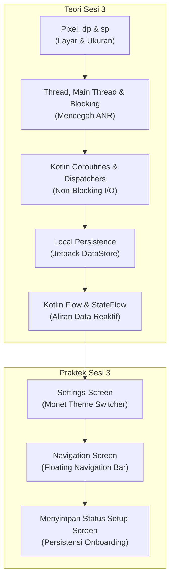
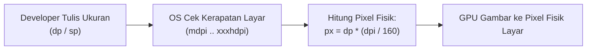
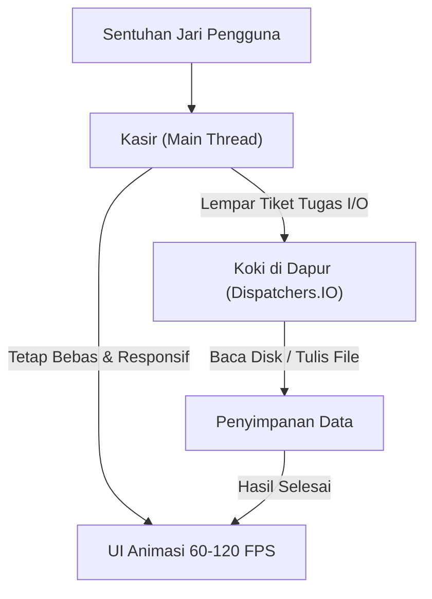
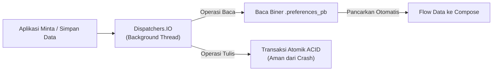
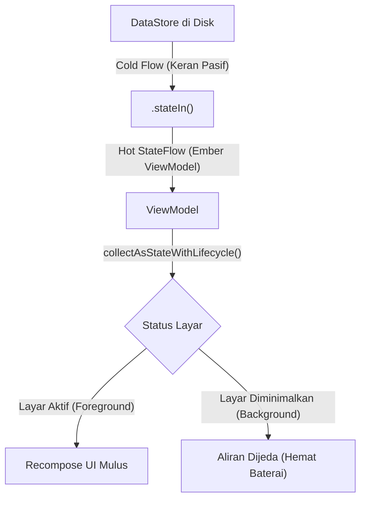
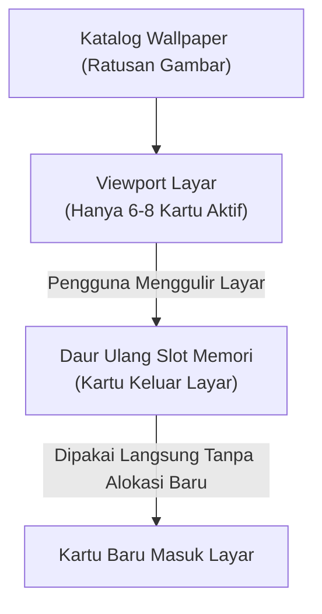
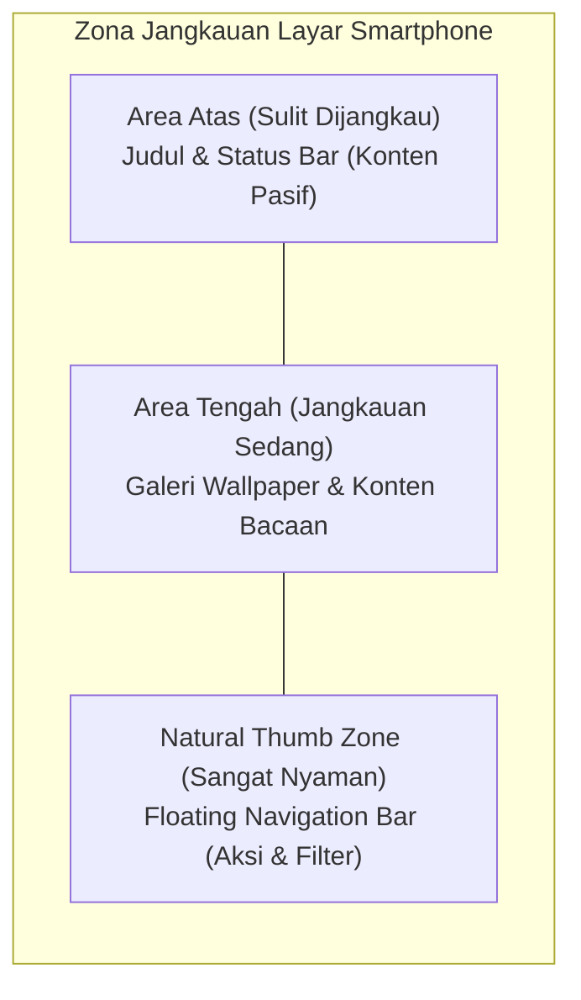

## Gambaran Umum Sesi 3

Di sesi ini, kita melanjutkan proyek LuminaWalls dari Sesi 2 untuk menambahkan beberapa fitur inti:

1. **Persistensi DataStore**: Mengganti state memori di `UserPreferencesRepository` dengan Jetpack DataStore Preferences agar setelan tema dan status onboarding tersimpan di perangkat.
2. **Katalog Grid 2 Kolom**: Mengganti `Row` statis di `HomeScreen.kt` dengan `LazyVerticalGrid` agar aplikasi bisa menampilkan daftar wallpaper yang panjang dengan efisien.
3. **Pilihan Tema di Settings**: Menambahkan opsi tema (Sistem, Terang, Gelap) di `SettingsScreen.kt`.
4. **Floating Nav Bar**: Memasang `FloatingNavBar` di `LuminaMainApp.kt` yang otomatis tampil di tab utama dan sembunyi saat membuka layar lain.

Cari komentar `// TODO: [Session 3]` di tiap berkas untuk menemukan lokasi kode yang perlu diisi.



---

## Teori & Konsep Fundamental Sesi 3

Sebelum masuk ke baris kode, kita pelajari 6 fondasi arsitektur yang menjadi alasan di balik kode yang kita tulis hari ini.

### 1. Fondasi Layar: `px` vs `dp` vs `sp`

* **Masalah Pixel Fisik (`px`):** Layar smartphone memiliki kerapatan pixel (*density*) yang berbeda-beda. Tombol berukuran `100px` akan tampak normal di layar resolusi rendah, tetapi menyusut drastis di layar flagship resolusi tinggi.
* **Solusi `dp` (Density-Independent Pixel):** Satuan virtual berbasis baseline 160 dpi. Menggunakan `dp` memastikan ukuran fisik elemen UI tetap seragam (~9mm untuk tombol 48dp) di semua jenis perangkat.
* **Skala Teks `sp` (Scale-Independent Pixel):** Mirip `dp`, tetapi nilainya otomatis menyesuaikan setelan *Font Size* aksesibilitas di sistem Android (misal bagi pengguna lansia).
* **Aturan Emas:** Gunakan `dp` untuk wadah, padding, margin, dan ikon. Gunakan `sp` secara eksklusif untuk seluruh hierarki teks.



---

### 2. Threading: Main Thread Budget, Blocking, & Coroutines

* **Analogi Kasir Restoran:** Main Thread adalah **Kasir**, sedangkan Worker Thread adalah **Koki di Dapur**. Tugas kasir hanya melayani antrean pesanan dan menggambar tampilan monitor.
* **Apa itu Blocking I/O?** Jika kasir disuruh memasak daging sendiri di meja kasir (misal: membaca file disk besar atau memanggil jaringan internet secara sinkron), antrean pelanggan macet total.
* **Jalur Bebas Hambatan & Bahaya ANR:** Main Thread bertugas menggambar UI dan merespons sentuhan jari secara instan. Jika Main Thread terblokir proses berat selama 5 detik tanpa merespons sentuhan, sistem Android memunculkan dialog **ANR (Application Not Responding)** untuk menutup paksa aplikasi.
* **Solusi Non-Blocking via Coroutines:** Main Thread melempar tugas I/O ke dapur lewat `Dispatchers.IO`. Main Thread tetap bebas menggambar frame layar tanpa lag.



---

### 3. Persistensi Data: SharedPreferences vs Jetpack DataStore vs Room

* **Dua Lokasi Folder (Root vs External):** Folder yang sering kita lihat di File Manager (`/sdcard/Android/data/`) itu cuma penyimpanan bersama / symlink untuk file unduhan besar. Rumah asli DataStore dan database tersimpan di partisi root privat (`/data/data/<package_name>/`) yang terkunci rapat dan tidak bisa dibuka aplikasi lain tanpa hak akses root.
* **Kelemahan SharedPreferences:** Menyimpan data dalam format teks XML lama. Membaca data memblokir Main Thread, dan operasi tulis rawan korup jika aplikasi mendadak crash.
* **Keunggulan Jetpack DataStore:** Dibangun murni di atas Kotlin Coroutines dan Flow. Menggunakan format biner `.preferences_pb` yang ringkas, berjalan asinkron di `Dispatchers.IO`, dan memiliki jaminan transaksi atomik (ACID).
* **Kapan Pakai Room?** Room (SQLite) ditujukan untuk data relasional kompleks ratusan baris. Untuk menyimpan preferensi sederhana (tema, token, filter), DataStore adalah pilihan yang jauh lebih ringan dan cepat.



---

### 4. Aliran Reaktif: Cold Flow ke Hot StateFlow & Lifecycle

* **Cold Flow (Keran Air Pasif):** DataStore memancarkan data secara pasif. Air baru mengalir saat keran dibuka (`collect`). Aliran otomatis berhenti saat tidak ada yang mendengar.
* **Hot StateFlow (Ember di Meja Kasir):** ViewModel menyimpan nilai mutakhir di memori. Kapan pun layar Compose dibuka, datanya langsung tersedia seketika tanpa layar berkedip kosong (*zero-flicker*).
* **Jembatan `.stateIn()`:** Mengubah Cold Flow dari DataStore menjadi Hot StateFlow di ViewModel dengan nilai awal (*initialValue*).
* **Lifecycle Awareness di Compose:** Memakai `collectAsStateWithLifecycle()` di layar memastikan aliran data otomatis dijeda saat aplikasi diminimalkan ke background, menghemat daya baterai ponsel.



---

### 5. Virtualisasi Tampilan: `Column` vs `LazyVerticalGrid`

* **Jebakan `Column` Biasa (Meja Jebol):** Membuat 500 kartu di `Column` memaksa Android merakit dan menaruh 500 node UI sekaligus ke RAM. Akibatnya memori jebol (*Out Of Memory Crash*).
* **Solusi Virtualisasi `LazyVerticalGrid` (Conveyor Belt Sushi):** Sistem hanya membuat 6–8 kartu yang tampak di dalam viewport layar. Saat kartu keluar dari layar, slot memorinya langsung didaur ulang untuk kartu baru yang masuk dari bawah.
* **Kunci Performa:** Wajib menggunakan `key = { it.id }` dan `contentType = { "card" }` agar Compose tidak mengulang komposisi dari awal saat urutan kartu bergeser.



---

### 6. Desain Ergonomi: Tonal Elevation M3 & Natural Thumb Zone

* **Tonal Elevation vs Drop Shadow:** Di Material 2, efek kedalaman dibuat dengan bayangan hitam pekat (*drop shadow*) yang tidak terlihat di Dark Mode. Di Material 3, kartu yang lebih tinggi diberi tint warna primer yang lebih terang (*Tonal Elevation*), tetap jelas di tema terang maupun gelap.
* **The Natural Thumb Zone:** Lebih dari 75% orang menggunakan ponsel 6.7 inci dengan satu tangan. Menaruh navigasi filter di atas layar menyiksa jempol. Meletakkannya di `FloatingNavBar` melayang di bawah layar menempatkan kontrol tepat di zona alami jangkauan jempol.



---

## Langkah 1: Tambahkan Dependensi DataStore Preferences

Buka berkas `app/build.gradle.kts`.

Cari komentar berikut:

```kotlin
    // TODO: [Session 3] Tambahkan DataStore Preferences untuk simpan setelan tema di bawah sini:
```

Tambahkan dependensi DataStore di bawahnya:

```kotlin
    implementation(libs.androidx.datastore.preferences)
```

Setelah itu, klik **Sync Now** di bar atas Android Studio dan tunggu proses sinkronisasi Gradle selesai.

> **Catatan:** Kita memakai `DataStore Preferences` sebagai pengganti `SharedPreferences`. DataStore berjalan secara asinkron lewat Coroutines dan Flow, jadi operasi baca-tulis file tidak memblokir main thread.

---

## Langkah 2: Hubungkan DataStore di `UserPreferencesRepository.kt`

Buka `app/src/main/kotlin/com/gdgoc/luminawalls/data/repository/UserPreferencesRepository.kt`.

### 1. Tambahkan Import
Pastikan import berikut ada di bagian atas berkas:

```kotlin

import androidx.datastore.core.DataStore
import androidx.datastore.preferences.core.Preferences
import androidx.datastore.preferences.core.booleanPreferencesKey
import androidx.datastore.preferences.core.edit
import androidx.datastore.preferences.core.stringPreferencesKey
import androidx.datastore.preferences.preferencesDataStore
import kotlinx.coroutines.CoroutineScope
import kotlinx.coroutines.Dispatchers
import kotlinx.coroutines.SupervisorJob
import kotlinx.coroutines.flow.SharingStarted
import kotlinx.coroutines.flow.map
import kotlinx.coroutines.flow.stateIn
import kotlinx.coroutines.launch
```

### 2. Inisialisasi Instance DataStore
Tepat di atas deklarasi `class UserPreferencesRepository`, tambahkan deklarasi delegasi DataStore:

```kotlin
private val Context.dataStore: DataStore<Preferences> by preferencesDataStore(name = "luminawalls_prefs")
```

### 3. Ganti StateFlow dan Setter
Di dalam `class UserPreferencesRepository`, cari komentar:

```kotlin
    // TODO: [Session 3] Ganti in-memory state ini dengan Jetpack DataStore Preferences di bawah sini:
```

Hapus deklarasi `_isSetupCompleted`, `isSetupCompleted`, `_themeMode`, dan fungsi setter lamanya, lalu ganti dengan kode berikut:

```kotlin
    private val scope = CoroutineScope(SupervisorJob() + Dispatchers.IO)

    val isSetupCompleted: StateFlow<Boolean> = context.dataStore.data
        .map { preferences -> preferences[KEY_SETUP_COMPLETED] ?: false }
        .stateIn(
            scope = scope,
            started = SharingStarted.Eagerly,
            initialValue = false,
        )

    val themeMode: StateFlow<AppThemeMode> = context.dataStore.data
        .map { preferences ->
            val modeName = preferences[KEY_THEME_MODE] ?: AppThemeMode.FOLLOW_SYSTEM.name
            try {
                AppThemeMode.valueOf(modeName)
            } catch (_: Exception) {
                AppThemeMode.FOLLOW_SYSTEM
            }
        }
        .stateIn(
            scope = scope,
            started = SharingStarted.Eagerly,
            initialValue = AppThemeMode.FOLLOW_SYSTEM,
        )

    fun setSetupCompleted(completed: Boolean) {
        scope.launch {
            context.dataStore.edit { preferences ->
                preferences[KEY_SETUP_COMPLETED] = completed
            }
        }
    }

    fun setThemeMode(mode: AppThemeMode) {
        scope.launch {
            context.dataStore.edit { preferences ->
                preferences[KEY_THEME_MODE] = mode.name
            }
        }
    }
```

### 4. Tambahkan Kunci Preferensi di `companion object`
Di blok `companion object`, tambahkan definisi dua kunci berikut:

```kotlin
        private val KEY_SETUP_COMPLETED = booleanPreferencesKey("setup_completed")
        private val KEY_THEME_MODE = stringPreferencesKey("theme_mode")
```

> Operator `stateIn` mengonversi Flow dari DataStore menjadi `StateFlow` agar nilainya bisa langsung dibaca oleh Compose tanpa menunggu emisi pertama.

<details>
<summary><strong>Kode Lengkap: `UserPreferencesRepository.kt`</strong></summary>

Jika ingin mencocokkan seluruh isi berkas, kamu bisa melihat kode lengkap berikut:

```kotlin
package com.gdgoc.luminawalls.data.repository

import android.content.Context
import androidx.datastore.core.DataStore
import androidx.datastore.preferences.core.Preferences
import androidx.datastore.preferences.core.booleanPreferencesKey
import androidx.datastore.preferences.core.edit
import androidx.datastore.preferences.core.stringPreferencesKey
import androidx.datastore.preferences.preferencesDataStore
import kotlinx.coroutines.CoroutineScope
import kotlinx.coroutines.Dispatchers
import kotlinx.coroutines.SupervisorJob
import kotlinx.coroutines.flow.SharingStarted
import kotlinx.coroutines.flow.StateFlow
import kotlinx.coroutines.flow.map
import kotlinx.coroutines.flow.stateIn
import kotlinx.coroutines.launch

enum class AppThemeMode {
    FOLLOW_SYSTEM,
    LIGHT,
    DARK,
}

private val Context.dataStore: DataStore<Preferences> by preferencesDataStore(name = "luminawalls_prefs")

class UserPreferencesRepository private constructor(private val context: Context) {

    private val scope = CoroutineScope(SupervisorJob() + Dispatchers.IO)

    val isSetupCompleted: StateFlow<Boolean> = context.dataStore.data
        .map { preferences -> preferences[KEY_SETUP_COMPLETED] ?: false }
        .stateIn(
            scope = scope,
            started = SharingStarted.Eagerly,
            initialValue = false,
        )

    val themeMode: StateFlow<AppThemeMode> = context.dataStore.data
        .map { preferences ->
            val modeName = preferences[KEY_THEME_MODE] ?: AppThemeMode.FOLLOW_SYSTEM.name
            try {
                AppThemeMode.valueOf(modeName)
            } catch (_: Exception) {
                AppThemeMode.FOLLOW_SYSTEM
            }
        }
        .stateIn(
            scope = scope,
            started = SharingStarted.Eagerly,
            initialValue = AppThemeMode.FOLLOW_SYSTEM,
        )

    fun setSetupCompleted(completed: Boolean) {
        scope.launch {
            context.dataStore.edit { preferences ->
                preferences[KEY_SETUP_COMPLETED] = completed
            }
        }
    }

    fun setThemeMode(mode: AppThemeMode) {
        scope.launch {
            context.dataStore.edit { preferences ->
                preferences[KEY_THEME_MODE] = mode.name
            }
        }
    }

    companion object {
        private val KEY_SETUP_COMPLETED = booleanPreferencesKey("setup_completed")
        private val KEY_THEME_MODE = stringPreferencesKey("theme_mode")

        @Volatile
        private var INSTANCE: UserPreferencesRepository? = null

        fun getInstance(context: Context): UserPreferencesRepository {
            return INSTANCE ?: synchronized(this) {
                INSTANCE ?: UserPreferencesRepository(context.applicationContext).also { INSTANCE = it }
            }
        }
    }
}
```

</details>

---

## Langkah 3: Tombol Settings dan Grid Galeri di `HomeScreen.kt`

Buka `app/src/main/kotlin/com/gdgoc/luminawalls/ui/screens/home/HomeScreen.kt`.

### 1. Tambahkan Import
Tambahkan baris import berikut jika belum ada:

```kotlin
import androidx.compose.foundation.layout.PaddingValues
import androidx.compose.foundation.layout.fillMaxSize
import androidx.compose.foundation.layout.size
import androidx.compose.foundation.lazy.grid.GridCells
import androidx.compose.foundation.lazy.grid.LazyVerticalGrid
import androidx.compose.foundation.lazy.grid.items
import androidx.compose.material.icons.Icons
import androidx.compose.material.icons.rounded.Settings
import androidx.compose.material3.Icon
import androidx.compose.material3.IconButton
import androidx.compose.material3.MaterialTheme
import androidx.compose.ui.res.stringResource
import androidx.compose.ui.unit.dp
import com.gdgoc.luminawalls.ui.components.WallpaperCard
```

### 2. Pasang Tombol Settings di Header
Cari komentar berikut di parameter `trailingAction`:

```kotlin
            // TODO: [Session 3] Tulis IconButton untuk membuka layar Pengaturan (onSettingsClick) di bawah sini:
```

Isi dengan `IconButton`:

```kotlin
            IconButton(
                onClick = onSettingsClick,
                modifier = Modifier.size(42.dp),
            ) {
                Icon(
                    imageVector = Icons.Rounded.Settings,
                    contentDescription = stringResource(R.string.action_settings),
                    tint = MaterialTheme.colorScheme.onSurface,
                    modifier = Modifier.size(26.dp),
                )
            }
```

### 3. Ganti Row Menjadi `LazyVerticalGrid`
Cari komentar berikut di dalam konten `LuminaScreenScaffold`:

```kotlin
        // TODO: [Session 3] Ubah menjadi LazyVerticalGrid 2 kolom di bawah sini:
```

Hapus blok `if (wallpapers.isNotEmpty()) { Row { ... } }` peninggalan Sesi 2, lalu ganti dengan grid 2 kolom:

```kotlin
        LazyVerticalGrid(
            columns = GridCells.Fixed(2),
            contentPadding = PaddingValues(start = 14.dp, end = 14.dp, top = 14.dp, bottom = 100.dp),
            horizontalArrangement = Arrangement.spacedBy(10.dp),
            verticalArrangement = Arrangement.spacedBy(12.dp),
            modifier = Modifier.fillMaxSize(),
        ) {
            items(
                items = wallpapers,
                key = { it.id },
            ) { wallpaper ->
                WallpaperCard(
                    wallpaper = wallpaper,
                    onWallpaperClick = onWallpaperClick,
                )
            }
        }
```

> Padding bawah `bottom = 100.dp` disiapkan agar kartu di baris terbawah tidak tertutup oleh navbar yang melayang di bawah layar.

---

## Langkah 4: Opsi Pemilihan Tema di `SettingsScreen.kt`

Buka `app/src/main/kotlin/com/gdgoc/luminawalls/ui/screens/settings/SettingsScreen.kt`.

### 1. Tambahkan Import
Pastikan import berikut sudah tersedia:

```kotlin
import androidx.compose.material.icons.rounded.BrightnessAuto
import androidx.compose.material.icons.rounded.DarkMode
import androidx.compose.material.icons.rounded.LightMode
import androidx.compose.ui.res.stringResource
import com.gdgoc.luminawalls.R
import com.gdgoc.luminawalls.ui.components.itemShapeFor
```

### 2. Pasang Opsi Tema
Cari komentar berikut di dalam bagian APPEARANCE:

```kotlin
                    // TODO: [Session 3] Tulis opsi pemilihan tema (System, Light, Dark) menggunakan ThemeOptionItem di bawah sini:
```

Tambahkan tiga opsi tema berikut:

```kotlin
                    ThemeOptionItem(
                        title = stringResource(R.string.settings_theme_system),
                        subtitle = stringResource(R.string.settings_theme_system_desc),
                        icon = Icons.Rounded.BrightnessAuto,
                        selected = currentThemeMode == AppThemeMode.FOLLOW_SYSTEM,
                        onClick = { onThemeModeSelected(AppThemeMode.FOLLOW_SYSTEM) },
                        shape = itemShapeFor(0, 3),
                    )

                    ThemeOptionItem(
                        title = stringResource(R.string.settings_theme_light),
                        subtitle = stringResource(R.string.settings_theme_light_desc),
                        icon = Icons.Rounded.LightMode,
                        selected = currentThemeMode == AppThemeMode.LIGHT,
                        onClick = { onThemeModeSelected(AppThemeMode.LIGHT) },
                        shape = itemShapeFor(1, 3),
                    )

                    ThemeOptionItem(
                        title = stringResource(R.string.settings_theme_dark),
                        subtitle = stringResource(R.string.settings_theme_dark_desc),
                        icon = Icons.Rounded.DarkMode,
                        selected = currentThemeMode == AppThemeMode.DARK,
                        onClick = { onThemeModeSelected(AppThemeMode.DARK) },
                        shape = itemShapeFor(2, 3),
                    )
```

> `itemShapeFor(index, total)` adalah fungsi helper bawaan proyek untuk membulatkan sudut atas pada item pertama, sudut bawah pada item terakhir, dan sudut datar untuk item di tengah.

---

## Langkah 5: Navigasi Settings dan Pasang FloatingNavBar di `LuminaMainApp.kt`

Buka `app/src/main/kotlin/com/gdgoc/luminawalls/ui/LuminaMainApp.kt`.

### 1. Hubungkan Aksi Buka Settings
Cari komentar berikut di parameter `onSettingsClick`:

```kotlin
                                        // TODO: [Session 3] Navigasikan ke SettingsScreen (AppScreen.Settings) di bawah sini:
```

Ubah layar aktif ke Settings:

```kotlin
                                        activeScreen = AppScreen.Settings
```

### 2. Pasang Floating Navigation Bar
Cari komentar berikut di bagian bawah `Box`:

```kotlin
                // TODO: [Session 3] Tulis Floating Navigation Bar di bagian bawah untuk navigasi tab Home & Contributors di bawah sini:
```

Tambahkan `FloatingNavBar` di dalam `AnimatedVisibility`:

```kotlin
                AnimatedVisibility(
                    visible = activeScreen is AppScreen.MainTab,
                    enter = slideInVertically(initialOffsetY = { it }) + fadeIn(),
                    exit = slideOutVertically(targetOffsetY = { it }) + fadeOut(),
                    modifier = Modifier.align(Alignment.BottomCenter),
                ) {
                    FloatingNavBar(
                        selectedTab = currentTab,
                        onTabSelected = { tab ->
                            currentTab = tab
                            activeScreen = AppScreen.MainTab(tab)
                        },
                    )
                }
```

> `AnimatedVisibility` membuat navbar otomatis muncul saat berada di layar utama (tab Home atau Contributors), dan otomatis sembunyi saat pengguna masuk ke layar Settings atau Preview.

---

## Pengujian

Jalankan aplikasi ke perangkat atau emulator (`Shift + F10`):

1. **Ganti Tema**:
   Buka ikon Settings di kanan atas, lalu pilih mode **Dark** atau **Light**. Pastikan warna latar dan kartu berubah sesuai pilihan.
2. **Uji Persistensi DataStore**:
   Pilih mode Dark, tutup aplikasi, lalu hilangkan aplikasi dari daftar Recent Apps (*force close*). Buka kembali aplikasi dan pastikan tema tetap berada di mode Dark.
3. **Navigasi Tab**:
   Ketuk tab **Contributors** pada navbar di bawah untuk memastikan perpindahan tab dan animasinya berjalan lancar.

---

## Simpan Checkpoint ke Git

Buka Terminal di Android Studio dan simpan progres Sesi 3:

```bash
git status
git add .
git commit -m "feat(sesi-3): implement datastore preferences, 2-column grid, theme switcher, and floating nav bar"
git push origin main
```
