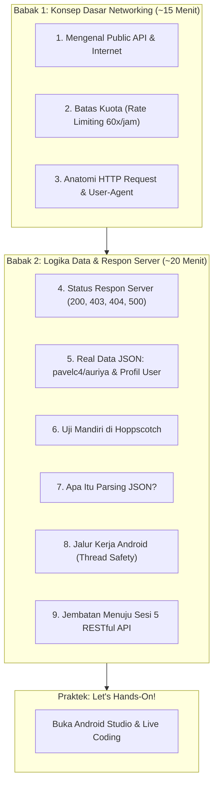
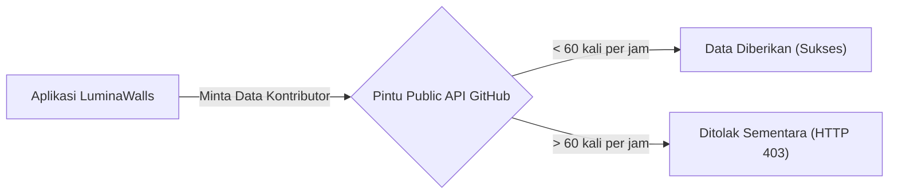
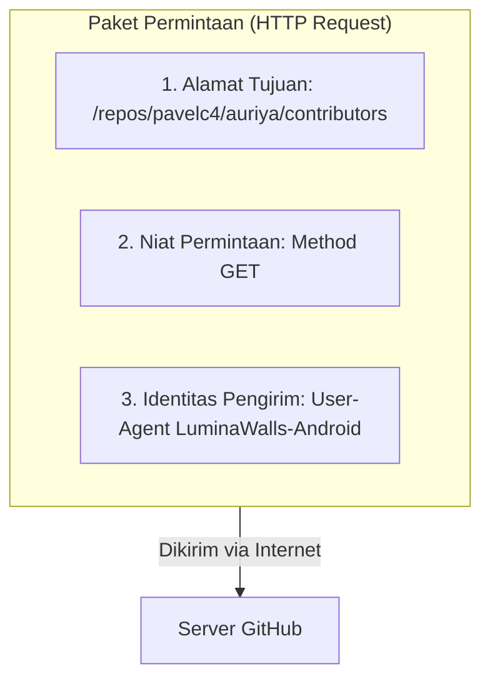
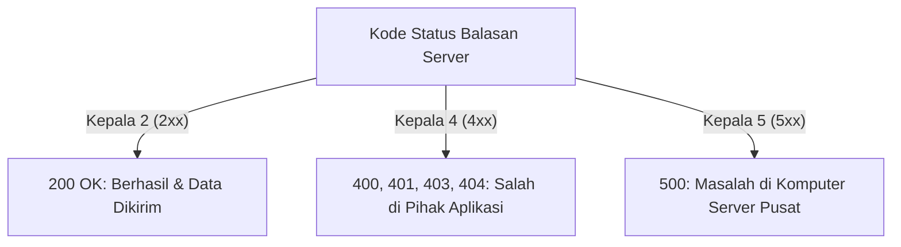
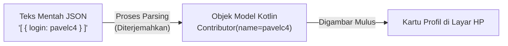

## Gambaran Umum Sesi 4

Selamat datang di **Sesi 4 GDGoC Study Jam: LuminaWalls Wallpaper App**!

Di Sesi 3, kita telah berhasil menyimpan setelan tema menggunakan Jetpack DataStore Preferences, membuat katalog galeri 2 kolom dengan `LazyVerticalGrid`, dan memasang bilah navigasi melayang.

Hari ini, di **Sesi 4**, fokus utama kita adalah **Backend & Networking**:
1. **Konsep Dasar Networking**: Memahami konsep Public API, batas panggilan gratis (*Rate Limiting*), dan anatomi smartphone saat mengirim permintaan (*HTTP Request* dengan contoh fiktif GET, POST, PATCH, DELETE).
2. **Logika Data & Respon Server**: Membedah arti status balasan server (*Response Code*), melihat contoh nyata data JSON dari repositori `pavelc4/auriya` dan profil pengguna, uji mandiri di Hoppscotch, memahami alasan perlu mengambil data profil untuk bio, proses penguraian data (*parsing*), aturan jalur kerja Android (*Thread Safety*), dan persiapan menuju Sesi 5.
3. **Praktek Koding**: Buka Android Studio untuk mengambil data kontributor langsung dari GitHub API dan menampilkannya di `ContributorsScreen`.



---

## Bagian 1: Konsep Dasar Networking

Bagian ini membahas cara aplikasi smartphone berkomunikasi dengan server internet menggunakan bahasa sehari-hari dan analogi visual.

---

### Topik 1: Pengenalan Public API di Dunia Mobile

Aplikasi smartphone yang kita gunakan sehari-hari membutuhkan dua jenis data:
1. **Data Lokal (Offline)**: Data yang disimpan di dalam memori smartphone. Datanya bisa dibuka kapan saja tanpa kuota internet, contohnya setelan tema gelap/terang atau daftar wallpaper bawaan.
2. **Data Remote (Online)**: Data yang berada di komputer server yang terhubung ke internet. Datanya selalu diperbarui setiap saat, contohnya daftar kontributor proyek yang terus bertambah di GitHub.

#### 1. Apa Itu Public API?
API (*Application Programming Interface*) adalah jembatan penghubung agar dua aplikasi berbeda bisa saling bertukar data.
- **Public API** adalah pintu layanan data yang dibuka gratis untuk umum oleh penyedia platform seperti GitHub.
- Kita bisa meminta data kontributor repositori tanpa perlu repot membuat dan menyewa server database sendiri.

#### 2. Public API vs Private API
- **Public API**: Pintu terbuka untuk umum, datanya tidak rahasia, contohnya daftar kontributor proyek open-source di GitHub atau perkiraan cuaca BMKG.
- **Private API**: Pintu tertutup yang dijaga ketat, butuh hak akses khusus, contohnya sistem transfer rekening bank atau data rekam medis.

#### 3. Batasan Panggilan: Apa Itu Rate Limiting?
Karena layanan Public API dibuka gratis untuk umum, server menerapkan aturan batas jumlah panggilan yang disebut **Rate Limiting**.
- Server GitHub membatasi pemanggilan API publik gratis hingga **maksimal 60 kali panggilan per jam** untuk satu alamat IP.
- Jika sebuah aplikasi memanggil lebih dari 60 kali dalam satu jam, GitHub akan menolak sementara panggilan berikutnya dan mengembalikan status penolakan (**HTTP 403 Forbidden**).
- Karena itu, aplikasi kita harus menyiapkan rencana cadangan agar tidak keluar sendiri saat kuota panggilan habis.



---

### Topik 2: Anatomi Permintaan (HTTP Request)

Saat smartphone ingin meminta data ke server, proses ini disebut mengirimkan **HTTP Request**. Sebuah permintaan memiliki 3 bagian utama:

#### 1. Endpoint (Alamat URL Tujuan)
Sama seperti menuliskan alamat tujuan pada paket pengiriman barang. Di GitHub, alamat untuk meminta daftar kontributor repositori berbeda dengan alamat untuk meminta detail profil pengguna:
- **Endpoint 1 (Daftar Kontributor Repositori)**:  
  `https://api.github.com/repos/pavelc4/auriya/contributors`  
  *(Memberikan daftar orang yang berkontribusi di repositori `auriya`)*
- **Endpoint 2 (Detail Profil Pemilik/User)**:  
  `https://api.github.com/users/pavelc4`  
  *(Memberikan detail informasi pengguna seperti nama lengkap, bio, blog, dan followers)*

#### 2. Mengenal 4 Kata Kerja Utama (HTTP Method)
Method memberi tahu server apa niat kita terhadap data tersebut:
- **`GET`**: Meminta atau membaca data yang sudah ada di server.
- **`POST`**: Mengirim dan membuat data baru di server.
- **`PATCH`**: Mengubah atau mengedit sebagian data yang sudah ada.
- **`DELETE`**: Menghapus data di server secara permanen.

---

#### 3. Contoh Fiktif Permintaan (Request) & Balasan (Response) untuk 4 Method

Biar teman-teman punya gambaran nyata dan mudah dipahami, kita gunakan **contoh fiktif aplikasi pemesanan di Kedai Kopi (`api.kedaikopi.com`)**:

##### A. Contoh Method GET: Mengambil / Melihat Data Pesanan
Ciri khas GET adalah suratnya ringkas dan enteng karena tidak membawa badan dokumen tambahan (*no request body*):

**Wujud Surat Request (HTTP Request):**
```http
GET /pesanan/42 HTTP/1.1
Host: api.kedaikopi.com
User-Agent: AplikasiKopi-Android
```

**Balasan dari Server (HTTP 200 OK):**
```json
{
  "id": 42,
  "menu": "Es Kopi Susu",
  "jumlah": 1,
  "status": "Sedang Dibuat"
}
```

---

##### B. Contoh Method POST: Mengirim & Membuat Pesanan Baru
Ciri khas POST adalah membawa badan surat (*Request Body*) berformat JSON yang berisi data pesanan baru untuk disimpan di database server:

**Wujud Surat Request (HTTP Request):**
```http
POST /pesanan HTTP/1.1
Host: api.kedaikopi.com
User-Agent: AplikasiKopi-Android
Content-Type: application/json

{
  "menu": "Roti Bakar Cokelat",
  "jumlah": 2
}
```

**Balasan dari Server (HTTP 201 Created):**
```json
{
  "id": 43,
  "menu": "Roti Bakar Cokelat",
  "jumlah": 2,
  "status": "Pesanan Berhasil Dibuat"
}
```

---

##### C. Contoh Method PATCH: Mengedit Sebagian Data Pesanan
Ciri khas PATCH adalah hanya mengirimkan potongan data yang ingin diubah saja tanpa mengutak-atik pesanan lainnya:

**Wujud Surat Request (HTTP Request):**
```http
PATCH /pesanan/43 HTTP/1.1
Host: api.kedaikopi.com
User-Agent: AplikasiKopi-Android
Content-Type: application/json

{
  "catatan": "Cokelatnya ditambah ekstra keju"
}
```

**Balasan dari Server (HTTP 200 OK):**
```json
{
  "id": 43,
  "menu": "Roti Bakar Cokelat",
  "catatan": "Cokelatnya ditambah ekstra keju",
  "status": "Pesanan Diperbarui"
}
```

---

##### D. Contoh Method DELETE: Membatalkan Pesanan
Ciri khas DELETE adalah meminta server melenyapkan data tertentu dari sistem:

**Wujud Surat Request (HTTP Request):**
```http
DELETE /pesanan/43 HTTP/1.1
Host: api.kedaikopi.com
User-Agent: AplikasiKopi-Android
```

**Balasan dari Server (HTTP 204 No Content):**
*(Badan balasan kosong tanpa teks JSON, karena data pesanan telah sukses dihapus oleh server)*

---

#### 4. Kesimpulan: Kenapa di Sesi Ini Kita Cuma Pakai GET?
- Keempat contoh tadi adalah gambaran umum bagaimana aplikasi smartphone berkomunikasi dengan backend server.
- Pada proyek **LuminaWalls** hari ini, aplikasi kita murni hanya bertugas **membaca dan menampilkan daftar kontributor** dari internet ke layar HP (`GET /repos/pavelc4/auriya/contributors`).
- Kita tidak sedang membuat akun baru (`POST`), mengedit biodata (`PATCH`), atau menghapus repositori orang lain (`DELETE`).
- **Catatan Header Pendukung di Permintaan Kita:**
  - **`User-Agent: LuminaWalls-Android`**: Berfungsi seperti **Caller ID / Nama Kontak di Layar HP**. Server GitHub mewajibkan tanda pengenal ini agar panggilan aplikasi kita tidak ditolak karena dianggap mencurigakan.
  - **`Accept: application/vnd.github.v3+json`**: Berisi keterangan bahwa format balasan yang kita minta adalah teks JSON.



---

## Bagian 2: Logika Data dan Respon Server

---

### Topik 3: Membaca Status Balasan Server (HTTP Response Code)

Setelah server menerima permintaan dari HP kita, server akan mengirimkan paket balasan yang selalu diawali dengan kode angka 3 digit yang disebut **HTTP Response Code**.



#### Membedah Status Code yang Sering Ditemui:
1. **`200 OK` (Sukses Besar)**:
   - Server berhasil menemukan data kontributor dan paket data siap diserahkan ke aplikasi kita.
   - Tindakan: Langsung kirim datanya ke layar untuk dibuatkan kartu profil.
2. **`400 Bad Request` (Permintaan Salah Tulis)**:
   - Server tidak mengerti apa yang kita minta karena format alamat atau parameternya keliru.
3. **`401 Unauthorized` (Butuh Izin Masuk)**:
   - Ruangan data ini dikunci dan butuh tiket masuk (seperti login akun atau token rahasia).
4. **`403 Forbidden` (Akses Ditolak / Kuota Habis)**:
   - Pada Public API GitHub, kode ini hampir selalu berarti kuota gratis 60 panggilan per jam kita sudah habis.
   - Tindakan: Aplikasi kita secara tenang beralih menampilkan data cadangan lokal.
5. **`404 Not Found` (Alamat Tidak Ditemukan)**:
   - Alamat URL atau nama repositori yang kita tuju salah ketik atau repositorinya sudah dihapus.
6. **`500 Internal Server Error` (Server Pusat Bermasalah)**:
   - Komputer server milik GitHub sedang mengalami gangguan internal. Ini bukan kesalahan dari aplikasi kita.

---

### Topik 4: Contoh Nyata Permintaan & Respon JSON dari GitHub & Apa Itu Parsing

Mari kita bedah contoh nyata data yang kita minta dari repositori asli [pavelc4/auriya](https://github.com/pavelc4/auriya).

#### Kasus 1: Mengambil Daftar Kontributor Repositori (`pavelc4/auriya`)
Smartphone kita mengirimkan permintaan HTTP:

```http
GET /repos/pavelc4/auriya/contributors HTTP/1.1
Host: api.github.com
User-Agent: LuminaWalls-Android
Accept: application/vnd.github.v3+json
```

Server GitHub membalas dengan status **`200 OK`** dan memberikan teks JSON asli berikut:

```json
[
  {
    "login": "pavelc4",
    "avatar_url": "https://avatars.githubusercontent.com/u/94319420?v=4",
    "html_url": "https://github.com/pavelc4",
    "contributions": 826
  },
  {
    "login": "dependabot[bot]",
    "avatar_url": "https://avatars.githubusercontent.com/in/29110?v=4",
    "html_url": "https://github.com/apps/dependabot",
    "contributions": 129
  },
  {
    "login": "BaiQiYu",
    "avatar_url": "https://avatars.githubusercontent.com/u/120947794?v=4",
    "html_url": "https://github.com/BaiQiYu",
    "contributions": 7
  },
  {
    "login": "Btema2",
    "avatar_url": "https://avatars.githubusercontent.com/u/111082893?v=4",
    "html_url": "https://github.com/Btema2",
    "contributions": 1
  }
]
```

##### Membedah Field Data Kontributor:
- **`"login"`**: Nama akun GitHub kontributor (`"pavelc4"`).
- **`"avatar_url"`**: Tautan alamat foto profil pengguna di internet.
- **`"html_url"`**: Tautan alamat profil web GitHub milik pengguna.
- **`"contributions"`**: Jumlah kontribusi commit yang sudah diberikan ke repositori (`826`).

---

#### Kasus 2: Kenapa di Data Kontributor Belum Ada Bio? (Fetch Profil User)
Perhatikan data kontributor di atas: tidak ada informasi nama lengkap (`name`), lokasi tinggal (`location`), atau deskripsi biodata (`bio`).

**Kenapa begitu?**  
Karena endpoint `/contributors` dirancang untuk memberikan **daftar ringkas yang cepat dan ringan**. Jika GitHub melampirkan biodata dan riwayat lengkap ratusan kontributor sekaligus dalam satu daftar, ukuran data akan menjadi sangat besar dan aplikasi kita lambat saat men-download.

Jika aplikasi kita ingin menampilkan **Bio**, **Nama Lengkap**, dan **Followers** kontributor, aplikasi kita mengirimkan permintaan kedua ke endpoint khusus profil pengguna:

```http
GET /users/pavelc4 HTTP/1.1
Host: api.github.com
User-Agent: LuminaWalls-Android
Accept: application/vnd.github.v3+json
```

Server GitHub membalas dengan status **`200 OK`** dan mengembalikan objek JSON detail user yang lengkap:

```json
{
  "login": "pavelc4",
  "id": 94319420,
  "name": "Dimas Dwi Ariyanto",
  "bio": "just an ordinary student | informatic enginering ",
  "location": "west java Bandung",
  "blog": "https://pavelc4.pages.dev",
  "avatar_url": "https://avatars.githubusercontent.com/u/94319420?v=4",
  "public_repos": 22,
  "followers": 39,
  "following": 9
}
```

Sekarang kita memiliki data lengkap: nama asli (`"Dimas Dwi Ariyanto"`), status bio (`"just an ordinary student | informatic enginering "`), lokasi di Bandung, website blog, dan jumlah followers!

---

#### Kasus 3: Mengambil Informasi Repositori (`pavelc4/auriya`)
Jika aplikasi kita ingin menampilkan kartu ringkasan proyek di bagian atas layar:

```http
GET /repos/pavelc4/auriya HTTP/1.1
Host: api.github.com
User-Agent: LuminaWalls-Android
```

Server GitHub membalas dengan status **`200 OK`**:

```json
{
  "name": "auriya",
  "full_name": "pavelc4/auriya",
  "description": "Yet another universal Magisk/KSU module. This repository experimental project.",
  "stargazers_count": 41,
  "forks_count": 8,
  "language": "Kotlin",
  "open_issues_count": 1
}
```

---

#### Kasus 4: Mengenal Struktur JSON Array `[ ]` vs JSON Object `{ }`
Memahami bentuk tanda kurung di JSON sangat penting sebelum menulis kodingan:

| Format JSON | Tanda Pembungkus | Kapan Digunakan? | Alat Pembaca di Android |
| :--- | :--- | :--- | :--- |
| **JSON Array** | Kurung Siku `[ ... ]` | Mengirim **daftar banyak hal** (misalnya daftar kontributor di `/contributors`) | `JSONArray` |
| **JSON Object** | Kurung Kurawal `{ ... }` | Mengirim **satu entitas detail** (misalnya profil 1 user di `/users/pavelc4` atau detail 1 repo) | `JSONObject` |

---

#### Kasus 5: Respon Saat Terjadi Salah Ketik (404 Not Found)
Jika alamat repositori salah ketik:

```http
GET /repos/pavelc4/auriya-tidak-ada HTTP/1.1
Host: api.github.com
User-Agent: LuminaWalls-Android
```

Server membalas dengan status **`404 Not Found`**:

```json
{
  "message": "Not Found",
  "documentation_url": "https://docs.github.com/rest/repos/repos#get-a-repository",
  "status": "404"
}
```

---

#### Kasus 6: Respon Saat Kuota Panggilan Habis (403 Forbidden Rate Limit)
Jika aplikasi telah memanggil lebih dari 60 kali dalam 1 jam tanpa login:

```http
GET /repos/pavelc4/auriya/contributors HTTP/1.1
```

Server membalas dengan status **`403 Forbidden`**:

```json
{
  "message": "API rate limit exceeded for your IP address. (Check documentation for details.)",
  "documentation_url": "https://docs.github.com/rest/overview/resources-in-the-rest-api#rate-limiting"
}
```

---

#### Kasus 7: Respon Daftar Kosong `[]`
Jika repositori masih baru atau belum ada kontributor lain yang commit, server tetap mengembalikan status **200 OK**, tetapi isi datanya adalah array kosong:

```json
[]
```

Aplikasi kita harus mengecek apakah daftar tersebut kosong; jika kosong, tampilkan pesan informatif atau muat data tim bawaan.

---

#### Rangkuman Logika Respon Aplikasi
| Status Code | Respon Server | Tindakan Aplikasi Kita |
| :--- | :--- | :--- |
| **200 OK** | Array data kontributor | Parse datanya dan gambar kartu profil di layar |
| **200 OK** | Array kosong `[]` | Tampilkan info bahwa belum ada kontributor |
| **403 Forbidden** | Pesan kuota limit habis | Langsung beralih ke data cadangan lokal aman |
| **404 Not Found** | Pesan data tidak ditemukan | Tampilkan peringatan alamat URL salah |
| **500 Error** | Pesan server pusat gangguan | Tampilkan info agar mencoba beberapa saat lagi |

---

#### Panduan Praktik Mandiri: Uji Coba API via Hoppscotch (`https://hoppscotch.io`)

Peserta bisa menguji langsung endpoint GitHub API secara mandiri tanpa perlu menginstall tools apa pun dan **tanpa perlu setting header**:

##### 1. Cara Menggunakan:
1. Buka browser di laptop atau smartphone: **`https://hoppscotch.io`**
2. Pastikan HTTP Method di sebelah kiri adalah **`GET`**.
3. Cukup salin dan tempel link endpoint di bawah ke kolom URL, lalu klik tombol **Send** berwarna ungu.
4. Amati Status Code (`200 OK` atau `404 Not Found`) dan teks format JSON di panel Response bawah.

##### 2. Tiga Link Endpoint untuk Dicoba:

| No | Kebutuhan Uji Coba | Link Endpoint URL (Tinggal Copas) | Respon yang Muncul |
| :---: | :--- | :--- | :--- |
| 1 | **Daftar Kontributor** | `https://api.github.com/repos/pavelc4/auriya/contributors` | Status **200 OK**, JSON Array `[ ... ]` daftar kontributor |
| 2 | **Profil & Bio User** | `https://api.github.com/users/pavelc4` | Status **200 OK**, JSON Object `{ ... }` berisi nama lengkap & bio |
| 3 | **Uji Salah Alamat (404)** | `https://api.github.com/repos/pavelc4/auriya-salah-ketik` | Status **404 Not Found**, JSON pesan error `"Not Found"` |

---

#### Apa Itu Parsing & Mengapa Itu Perlu?
Teks JSON yang kita lihat di atas dikirimkan melalui internet sebagai **deretan teks huruf mentah (String)** biasa.
Komputer HP kita tidak bisa langsung melempar teks mentah tersebut ke layar begitu saja. Layar Jetpack Compose butuh objek data Kotlin yang rapi.

**Parsing** adalah proses membaca, membedah, dan menerjemahkan teks mentah JSON tersebut menjadi **Objek Data Bahasa Kotlin** (`Contributor(name, avatarUrl, bio)`).

#### Analogi Bahan Masakan Mentah di Dapur
> - **Teks Mentah JSON**: Seperti sekeranjang ayam mentah dan sayuran mentah yang baru diantar dari pasar. Tamu di restoran tentu tidak bisa makan ayam mentah.
> - **Proses Parsing**: Adalah **koki di dapur** yang mencuci sayuran, memotong ayam, dan memasaknya hingga matang.
> - **Hasil Parsing (Model Kotlin)**: Sepiring hidangan sate ayam lezat siap santap yang langsung bisa disajikan ke meja tamu (digambar rapi di layar HP).



---

### Topik 5: Jalur Kerja Android (Thread Safety & Graceful Fallback)

#### 1. Mengapa Operasi Internet Dilarang di Jalur Utama (Main Thread)?
Main Thread di Android bertugas menggambar animasi layar sebanyak 60 sampai 120 kali per detik dan membaca setiap ketukan jari pengguna.

Mengambil data dari internet membutuhkan waktu 1 sampai 3 detik. Jika Main Thread disuruh menunggu internet:
- Layar HP langsung membeku (*freeze*).
- Tombol tidak bisa ditekan sama sekali.
- Sistem operasi Android langsung menghentikan paksa aplikasi dengan pesan error: **`NetworkOnMainThreadException`**.

#### 2. Solusinya: Menggunakan Jalur Belakang (`Dispatchers.IO`)
Operasi internet wajib dipindahkan ke jalur belakang khusus yang bernama **`Dispatchers.IO`**:
- **Main Thread**: Tetap lancar menggambar animasi di layar depan.
- **Dispatchers.IO**: Bekerja tenang di belakang untuk mengambil data internet dan mem-parsing JSON.

#### 3. Rencana Cadangan (Graceful Fallback)
Koneksi internet di smartphone bisa terputus sewaktu-waktu (misalnya saat pengguna masuk ke lift atau kuota 60 request per jam habis).
Aplikasi yang profesional tidak boleh langsung menutup paksa (*crash*). Kita menyiapkan **`initialContributors`** sebagai data cadangan di memori HP. Jika jaringan gagal, aplikasi tetap menampilkan kartu profil tim dengan tenang.

---

### Topik 6: Hubungan Menuju Sesi 5 RESTful API

Materi networking di Sesi 4 ini adalah batu loncatan penting untuk materi puncak di Sesi 5:
- **Di Sesi 4 (Hari Ini)**: Kita memahami fondasi dasar: Public API, Request, Response Code, Parsing manual dari teks JSON mentah, dan memindahkan operasi ke jalur belakang.
- **Di Sesi 5 (Minggu Depan)**: Kita akan mengintegrasikan library standar industri seperti **OkHttp** dan **Coil** untuk mengunduh ribuan gambar wallpaper asli dari server cloud remote.
- **Puncak Sesi 5**: Kita akan menyambungkan tombol unduh di aplikasi ke fitur bawaan Android bernama **`WallpaperManager`**. Begitu tombol ditekan, wallpaper di layar beranda dan lockscreen smartphone kalian akan berubah secara nyata!

---

## Bagian 3: Panduan Praktik Koding di Android Studio

Setelah memahami seluruh teorinya, sekarang kita buka Android Studio dan langsung mempraktikkan kodingannya.

Target kodingan kita hari ini:
1. Membuat chip label kategori `WallpaperTag` di `WallpaperCard.kt`.
2. Menyeragamkan tombol kembali bundar `FilledIconButton` di layar Settings dan Preview.
3. Menyambungkan navigasi klik kartu galeri ke layar `PreviewScreen`.
4. Merakit tata letak layar `ContributorsScreen.kt`.
5. Mengintegrasikan pemanggilan live REST API GitHub dan parsing JSON di `ContributorRepository.kt`.
6. Menjalankan aplikasi di smartphone fisik dan menyimpan commit git.

---

## Langkah 1: Buat Komponen Chip Label `WallpaperTag` di `WallpaperCard.kt`

Buka berkas `app/src/main/kotlin/com/gdgoc/luminawalls/ui/components/WallpaperCard.kt`.  
Pastikan import berikut sudah ada di bagian atas file:

```kotlin title="ui/components/WallpaperCard.kt"
import androidx.compose.ui.unit.sp
import com.gdgoc.luminawalls.theme.GoogleSansRounded
```

Cari penanda `TODO: [Session 4]` di fungsi `WallpaperTag`, lalu lengkapi kode Surface dan Text berikut:

```kotlin title="ui/components/WallpaperCard.kt"
@Composable
fun WallpaperTag(
    text: String,
    modifier: Modifier = Modifier,
) {
    // TODO: [Session 4] Tulis Surface dan Text chip kategori di bawah sini:
    Surface(
        shape = RoundedCornerShape(100),
        color = MaterialTheme.colorScheme.surfaceContainerHigh.copy(alpha = 0.88f),
        contentColor = MaterialTheme.colorScheme.onSurface,
        modifier = modifier,
    ) {
        Text(
            text = text,
            style = MaterialTheme.typography.labelSmall,
            fontFamily = GoogleSansRounded,
            fontWeight = FontWeight.SemiBold,
            fontSize = 11.sp,
            modifier = Modifier.padding(horizontal = 9.dp, vertical = 4.dp),
        )
    }
}
```

---

## Langkah 2: Seragamkan Tombol Kembali `FilledIconButton` di Sub-Layar

Kita memasang tombol kembali bulat Material 3 (`FilledIconButton`) dengan ikon panah di layar Settings dan Preview.

### 2.1 Pasang di `SettingsScreen.kt`
Buka berkas `app/src/main/kotlin/com/gdgoc/luminawalls/ui/screens/settings/SettingsScreen.kt`.  
Pastikan import berikut sudah ada di bagian atas file:

```kotlin title="ui/screens/settings/SettingsScreen.kt"
import androidx.compose.foundation.shape.CircleShape
import androidx.compose.material.icons.automirrored.rounded.ArrowBack
import androidx.compose.material3.FilledIconButton
import androidx.compose.material3.IconButtonDefaults
```

Cari parameter `leadingAction` pada `LuminaScreenScaffold`:

```kotlin title="ui/screens/settings/SettingsScreen.kt"
leadingAction = {
    // TODO: [Session 4] Tulis FilledIconButton kembali (onBackClick) di bawah sini:
    FilledIconButton(
        onClick = onBackClick,
        shape = CircleShape,
        colors = IconButtonDefaults.filledIconButtonColors(
            containerColor = MaterialTheme.colorScheme.surfaceContainerHigh,
            contentColor = MaterialTheme.colorScheme.onSurface,
        ),
        modifier = Modifier.size(42.dp),
    ) {
        Icon(
            imageVector = Icons.AutoMirrored.Rounded.ArrowBack,
            contentDescription = stringResource(R.string.action_back),
            modifier = Modifier.size(20.dp),
        )
    }
},
```

### 2.2 Pasang di `PreviewScreen.kt`
Buka berkas `app/src/main/kotlin/com/gdgoc/luminawalls/ui/screens/preview/PreviewScreen.kt`.  
Pastikan import berikut sudah ada di bagian atas file:

```kotlin title="ui/screens/preview/PreviewScreen.kt"
import androidx.compose.ui.res.stringResource
import com.gdgoc.luminawalls.R
```

Cari komentar `TODO: [Session 4]` di dalam Top Bar, lalu isi tombol kembalinya saja (jangan menyalin ulang `Spacer` dan `Column` yang sudah ada di bawahnya):

```kotlin title="ui/screens/preview/PreviewScreen.kt"
// TODO: [Session 4] Tulis FilledIconButton kembali (onBackClick) di bawah sini:
FilledIconButton(
    onClick = onBackClick,
    shape = CircleShape,
    colors = IconButtonDefaults.filledIconButtonColors(
        containerColor = MaterialTheme.colorScheme.surfaceContainerHigh,
        contentColor = MaterialTheme.colorScheme.onSurface,
    ),
    modifier = Modifier.size(42.dp),
) {
    Icon(
        imageVector = Icons.AutoMirrored.Rounded.ArrowBack,
        contentDescription = stringResource(R.string.action_back),
        modifier = Modifier.size(20.dp),
    )
}
```

---

## Langkah 3: Sambungkan Navigasi Layar ke `PreviewScreen`

Buka berkas `app/src/main/kotlin/com/gdgoc/luminawalls/ui/LuminaMainApp.kt`.  
Cari komentar `TODO: [Session 4]` di dalam `HomeScreen(..., onWallpaperClick = { wall -> ... })`, lalu lengkapi navigasinya:

```kotlin title="ui/LuminaMainApp.kt"
// TODO: [Session 4] Navigasikan ke PreviewScreen (AppScreen.Preview(wall)) di bawah sini:
activeScreen = AppScreen.Preview(wall)
```

---

## Langkah 4: Susun Layar `ContributorsScreen.kt`

Buka berkas `app/src/main/kotlin/com/gdgoc/luminawalls/ui/screens/contributors/ContributorsScreen.kt`.  
Ada dua bagian `TODO: [Session 4]` yang perlu dilengkapi:

### 4.1 Susun Blok Hero, Tim & Kontributor di `LazyColumn`
Cari komentar `TODO: [Session 4]` di dalam `LazyColumn`:

```kotlin title="ui/screens/contributors/ContributorsScreen.kt"
// TODO: [Session 4] Buat LuminaHeroCard, GdgocTeamBlock, dan ContributorsBlock di bawah sini:
item(key = "hero_card") {
    LuminaHeroCard()
}

item(key = "team_header") {
    SectionHeader(
        title = androidx.compose.ui.res.stringResource(com.gdgoc.luminawalls.R.string.about_team_title),
        subtitle = androidx.compose.ui.res.stringResource(com.gdgoc.luminawalls.R.string.about_team_subtitle),
    )
}

item(key = "team_cards") {
    GdgocTeamBlock(
        onInstructorClick = { openUrl("https://github.com/pavelc4") },
        onCoreTeamClick = { openUrl("https://www.instagram.com/gdgocwidyatama?xtok=MWh5Z2N6NnJzdHJhZg==") },
    )
}

item(key = "contributors_header") {
    SectionHeader(
        title = androidx.compose.ui.res.stringResource(com.gdgoc.luminawalls.R.string.about_contributors_title),
        subtitle = androidx.compose.ui.res.stringResource(com.gdgoc.luminawalls.R.string.about_contributors_subtitle),
    )
}

item(key = "contributors_list") {
    ContributorsBlock(
        contributors = contributors,
        onOpenGithub = { openUrl(it) },
    )
}
```

### 4.2 Tampilkan Daftar Kontributor di `ContributorsBlock`
Gulir ke bagian bawah file pada fungsi `ContributorsBlock`, lalu lengkapi `TODO: [Session 4]`:

```kotlin title="ui/screens/contributors/ContributorsScreen.kt"
// TODO: [Session 4] Tampilkan daftar kontributor menggunakan Column, LuminaListItem, dan avatar foto di bawah sini:
Column(
    modifier = modifier.fillMaxWidth(),
    verticalArrangement = Arrangement.spacedBy(3.dp),
) {
    val contributorBadge =
        androidx.compose.ui.res.stringResource(com.gdgoc.luminawalls.R.string.about_badge_contributor)

    contributors.forEachIndexed { index, contributor ->
        val avatarUrl = contributor.avatarUrl ?: "https://github.com/${contributor.name}.png"
        LuminaListItem(
            title = contributor.name,
            shape = itemShapeFor(index, contributors.size),
            trailingBadgeText = contributorBadge,
            onClick = { onOpenGithub(contributor.github) },
            leadingContent = {
                Surface(
                    shape = CircleShape,
                    color = MaterialTheme.colorScheme.primaryContainer,
                    modifier = Modifier.size(44.dp),
                ) {
                    NetworkImage(
                        url = avatarUrl,
                        contentDescription = contributor.name,
                        modifier = Modifier
                            .fillMaxSize()
                            .clip(CircleShape),
                    )
                }
            },
        )
    }
}
```

---

## Langkah 5: Integrasi REST API GitHub di `ContributorRepository.kt`

Buka berkas `app/src/main/kotlin/com/gdgoc/luminawalls/data/repository/ContributorRepository.kt`.

### 5.1 Tambahkan Import
Tambahkan 3 import berikut di bagian atas file:

```kotlin title="data/repository/ContributorRepository.kt"
import java.net.HttpURLConnection
import java.net.URL
import org.json.JSONArray
```

### 5.2 Atur URL Repositori Target
Cari komentar `TODO: [Session 4]` pertama dan arahkan ke repositori target (misalnya `pavelc4/auriya` atau repositori milikmu sendiri):

```kotlin title="data/repository/ContributorRepository.kt"
// TODO: [Session 4] Masukkan URL repositori GitHub LuminaWalls kamu di bawah sini:
const val DEFAULT_REPO_URL = "https://github.com/pavelc4/auriya"
```

### 5.3 Eksekusi Request & Parsing JSON di `fetchFromGitHub`
Cari komentar `TODO: [Session 4]` di dalam fungsi `fetchFromGitHub(...)`, lalu lengkapi dengan kode berikut (hapus `emptyList()` placeholder di bawahnya) dan tambahkan fungsi helper `resolveApiUrl`:

```kotlin title="data/repository/ContributorRepository.kt"
// TODO: [Session 4] Eksekusi REST API GitHub untuk mengambil daftar kontributor di bawah sini:
val apiUrl = resolveApiUrl(targetUrlOrRepo)
val connection = (URL(apiUrl).openConnection() as HttpURLConnection).apply {
    requestMethod = "GET"
    connectTimeout = 10_000
    readTimeout = 10_000
    setRequestProperty("User-Agent", "LuminaWalls-Android")
    setRequestProperty("Accept", "application/vnd.github.v3+json")
}

try {
    val code = connection.responseCode
    if (code != HttpURLConnection.HTTP_OK) {
        return@withContext emptyList()
    }

    val jsonText = connection.inputStream.bufferedReader().use { it.readText() }
    val jsonArray = JSONArray(jsonText)
    val result = mutableListOf<Contributor>()

    for (i in 0 until jsonArray.length()) {
        val obj = jsonArray.getJSONObject(i)
        val login = obj.optString("login", "")
        if (login.isBlank() || login.contains("[bot]")) continue

        val avatarUrl = obj.optString("avatar_url", "")
        val htmlUrl = obj.optString("html_url", "")

        result.add(
            Contributor(
                name = login,
                role = "Contributor",
                github = htmlUrl,
                bio = "Active contributor to open-source repository",
                avatarLetter = login.take(1).uppercase(),
                avatarUrl = avatarUrl.ifBlank { null },
            )
        )
    }

    result
} finally {
    connection.disconnect()
}
```

Tambahkan helper `resolveApiUrl` di dalam `object ContributorRepository` (di bawah `fetchFromGitHub`):

```kotlin title="data/repository/ContributorRepository.kt"
private fun resolveApiUrl(target: String): String {
    val trimmed = target.trim().trimEnd('/')
    return when {
        trimmed.startsWith("https://api.github.com/repos/") -> {
            if (trimmed.contains("/contributors")) trimmed else "$trimmed/contributors?per_page=100"
        }
        trimmed.startsWith("https://github.com/") -> {
            val path = trimmed.removePrefix("https://github.com/")
            "https://api.github.com/repos/$path/contributors?per_page=100"
        }
        trimmed.contains("/") -> {
            "https://api.github.com/repos/$trimmed/contributors?per_page=100"
        }
        else -> "https://api.github.com/repos/pavelc4/auriya/contributors?per_page=100"
    }
}
```

---

## Langkah 6: Pengujian Aplikasi di Smartphone Fisik & Commit Git

1. Pasang kabel data ke smartphone Android dan aktifkan **USB Debugging**.
2. Klik tombol **Run 'app'** (ikon segitiga hijau) di Android Studio.
3. Buka tab **Contributors**:
   - Pastikan indikator loading berputar sejenak.
   - Amati daftar kontributor nyata dari GitHub yang berhasil ditarik dan digambar menjadi kartu profil.
   - Ketuk salah satu kartu kontributor untuk menguji apakah browser HP berhasil membuka tautan profil GitHub-nya.
4. Simpan hasil kodingan kalian ke Git:
   ```bash
   git add .
   git commit -m "feat: complete session 4 - public api, http networking and json parsing"
   ```

---

## Kesimpulan Sesi 4

Hari ini kita telah menguasai:
1. **Public API & Rate Limiting**: Memahami pintu layanan data gratis dan batas 60 request per jam per IP.
2. **HTTP Request Anatomy**: Membedah wujud asli teks surat permintaan, metode `GET`, dan header `User-Agent: LuminaWalls-Android` (analogi Caller ID di layar HP).
3. **HTTP Response Codes**: Mengetahui perbedaan arti status 200 OK, 403 Forbidden, 404 Not Found, dan 500 Server Error.
4. **Real JSON Data**: Membedah langsung teks JSON dari repositori `pavelc4/auriya`, profil user `pavelc4`, dan memahami kenapa bio diambil lewat endpoint user.
5. **JSON Parsing**: Mengolah teks mentah JSON menjadi objek model Kotlin siap saji (`JSONArray` vs `JSONObject`).
6. **Thread Safety**: Menjaga Main Thread tetap lancar dengan memindahkan operasi internet ke `Dispatchers.IO`.

Sampai jumpa di **Sesi 5 (Grand Finale Capstone)**! Kita akan mengintegrasikan OkHttp, Coil, dan fitur native `WallpaperManager` untuk mengganti wallpaper smartphone secara nyata!
